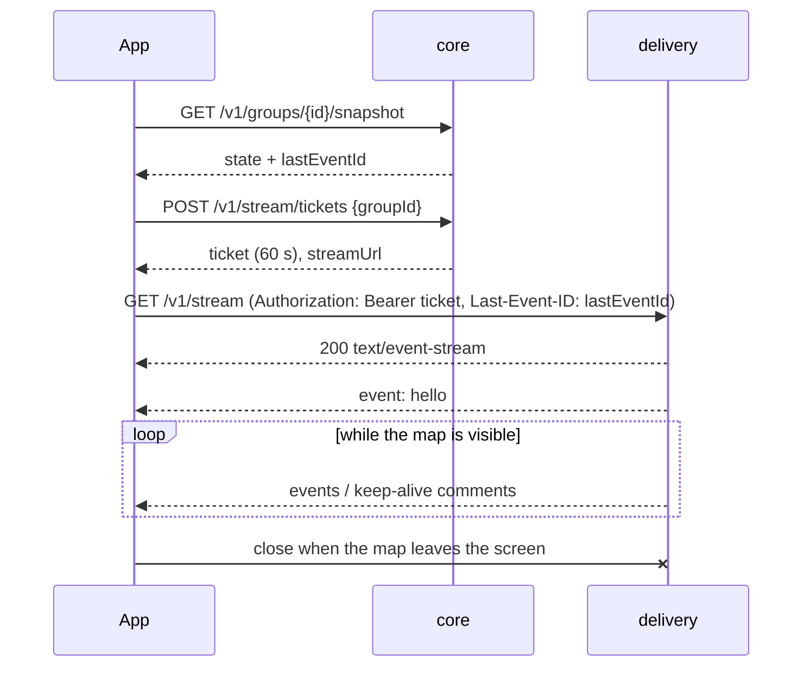

# Realtime protocol

> Status: draft for blueprint review · Last updated: 2026-11-15
> Related: [API guide](README.md) · contract — [`api/openapi.yaml`](../../api/openapi.yaml) · [flows](../architecture/flows.md) · [ADR-005](../architecture/adr/ADR-005-stream-tickets.md) · [ADR-006](../architecture/adr/ADR-006-realtime-sse-with-polling-fallback.md)

## 1. Purpose and scope

The stream delivers changes of **one group** to a viewer who has that group's map on screen: positions, member statuses, places, SOS and results of fresh-location requests. It is one-way (server to client) and uses Server-Sent Events over HTTPS. Commands go through the REST API.

Three other channels exist and are **not** this protocol:

| Channel | Direction | Described in |
|---|---|---|
| Device reports | Phone → core | [API guide §10](README.md) |
| Commands to the location engine (piggyback) | Core → phone, in report responses | [API guide §10](README.md) |
| Push messages | Core → `delivery` → FCM → phone | §9 below |

## 2. Lifecycle



1. **Snapshot first.** The app loads the group snapshot; it contains `lastEventId`.
2. **Ticket.** The app requests a stream ticket for that group. The ticket carries the viewer's entitlements (§4).
3. **Open.** `GET /v1/stream` with headers `Accept: text/event-stream`, `Authorization: Bearer <ticket>` and `Last-Event-ID: <lastEventId>`.
4. **Events.** The app applies events on top of the snapshot (§6).
5. **Close.** The app closes the stream when the map is no longer visible. The stream is never kept open in the background.

One stream serves one group. Switching the group on the map closes the stream and opens another.

## 3. Wire format

Standard SSE framing:

```
id: 184501
event: position
data: {"groupId":"9c1e…","userId":"a3f1…","position":{"lat":50.4501,"lon":30.5234,"accuracyM":12.5,"fixedAt":"2026-11-15T16:20:30Z","flags":[]},"freshness":"live","lastSeenAt":"2026-11-15T16:20:31Z"}

```

- `id` — a decimal string that increases over time. Only its order matters.
- `event` — the event type (§5).
- `data` — one JSON object on a single line, `camelCase`, same field definitions as the REST contract.
- Lines starting with `:` are keep-alive comments, sent every 20 s.
- The server sends `retry: 3000` once after connecting.
- Clients ignore unknown event types and unknown fields.

## 4. Entitlements

The ticket states what the viewer may receive for the group. `delivery` only matches each event's class against the ticket; it makes no decisions of its own.

| Class | Events | Granted to |
|---|---|---|
| `status` | `member`, `group`, `place`, `request` | Every current member of the group |
| `position` | `position` | Members whose own sharing is active (reciprocity) |
| `sos` | `sos`, and `position` events of a member with an active SOS | Every current member of the group |

When access changes — the viewer pauses or resumes, is removed, leaves, signs out, or the group is deleted — the stream receives `reconnect` and is closed. The app then reloads the snapshot and asks for a new ticket (which may fail with `404` if access is gone).

## 5. Events

| Event | Class | When | `data` |
|---|---|---|---|
| `hello` | — | Right after connecting | `{ "serverTime", "groupId", "entitlements": ["status","position","sos"], "maxAgeS" }` |
| `position` | `position` or `sos` | A member's current position changed | `{ "groupId", "userId", "position": Position, "freshness", "lastSeenAt", "sos": boolean }` |
| `member` | `status` | A member's visible state changed: sharing state or pause, freshness category, device flags, battery, role; joined; left or removed | `{ "groupId", "userId", "change": "updated" \| "joined" \| "left" \| "removed", "member": MemberView without position }` — `member` is absent for `left` and `removed` |
| `group` | `status` | Group renamed | `{ "groupId", "name" }` |
| `place` | `status` | Place created, changed or deleted | `{ "groupId", "placeId", "change": "created" \| "updated" \| "deleted", "place": Place }` — `place` is absent for `deleted` |
| `sos` | `sos` | SOS started or ended | `{ "groupId", "sos": Sos }` |
| `request` | `status` | The viewer's own fresh-location request was resolved | `{ "requestId", "status": "fulfilled" \| "timed_out" }` — sent only to the requester |
| `resync` | — | The server cannot replay from `Last-Event-ID` | `{ "reason" }` — reload the snapshot |
| `reconnect` | — | Access changed, or the maximum stream lifetime was reached | `{ "reason": "access_changed" \| "max_age" \| "shutdown" }` — the server closes the stream afterwards |

`Position`, `MemberView`, `Place` and `Sos` are the schemas of `api/openapi.yaml`.

Notes:

- A `member` event never contains a position; positions travel only in `position` events, so a viewer without the `position` entitlement still receives statuses.
- Freshness changes that happen without a report (a member becoming stale or offline) are published by the core's watchdog as `member` events.
- Arrival and departure alerts are push messages, not stream events; the map does not need them.

## 6. Applying events

The client keeps the snapshot as its state and applies each event idempotently:

| Event | Rule |
|---|---|
| `position` | Replace the member's position only if `position.fixedAt` is later than the stored one. Update `freshness` and `lastSeenAt` |
| `member` | Replace the member's status fields; remove the member on `left` / `removed`; add on `joined` |
| `place`, `group`, `sos` | Replace by id |
| Any event with an `id` not greater than the snapshot's `lastEventId` | Ignore |

Order between different members does not matter. Duplicates are possible (delivery is at-least-once) and harmless under these rules. The map never interpolates between positions.

The "N min ago" labels are computed from `fixedAt`, `lastSeenAt` and the offset between `serverTime` and the phone clock; the freshness category itself always comes from the server.

## 7. Reconnection and fallback

| Situation | Client behaviour |
|---|---|
| Connection dropped | Request a **new ticket** (tickets are single-use), reconnect with `Last-Event-ID` of the last applied event. Back-off: 1 s, 2 s, 5 s, 10 s, then every 30 s, with jitter |
| `reconnect` received | Reload the snapshot, request a new ticket, reconnect |
| `resync` received | Reload the snapshot; keep the stream |
| Ticket request returns `404` | Access to the group is gone: leave the map |
| Stream unavailable for more than 10 s | Start polling the snapshot every 30 s; keep retrying the stream; stop polling when it is back |
| No bytes for 45 s | Treat as dropped |

Server side: `delivery` keeps a short replay buffer per group (the last few minutes of events). If `Last-Event-ID` is older than the buffer, it sends `resync`. Every stream is closed with `reconnect` (`max_age`) after 15 min *(config)*; the client reconnects transparently.

## 8. Viewer presence and active view

An open stream with the `position` entitlement means "this group is being watched by a sharing member". `delivery` reports the set of such viewers per group to the core every 30 s and on every change. The core grants **active-view leases** to the group's sharing members (2 min, renewed while presence lasts, capped at 15 min in a row, then a 5 min cool-down *(spike)*), and their phones show who is viewing.

Consequences for clients: keep the stream open only while the map is really visible; do not open streams for groups that are not on screen. Polling the snapshot does not create presence.

## 9. Push messages

Push messages are FCM data messages sent by `delivery` on the core's instruction. They contain a type and identifiers only — never coordinates, names or place names. The app fetches or looks up what it needs and builds the notification text from its own string resources.

| `type` | Priority | Payload | Phone behaviour |
|---|---|---|---|
| `locate` | High for `request`, `revival`, `operator`; **normal** for `active_view` | `reason`: `request` \| `active_view` \| `revival` \| `operator`; `requestId?`; `requesterUserId?` | Hand to the location engine; visible notification for requests and revival; for active view only the text of the running service's notification changes |
| `pause-ended` | High | `pauseRev` | Resume sharing if Android allows the start, otherwise "Pause ended — tap to resume" |
| `sos` | High | `sosId`, `userId`, `state`: `started` \| `ended` | High-importance notification; open the SOS on the map |
| `place` | High | `groupId`, `placeId`, `userId`, `kind`: `arrival` \| `departure`, `occurredAt` | Notification |
| `group-event` | Normal | `groupId`, `event`: `joined` \| `left` \| `removed` \| `role_changed` \| `group_deleted` \| `place_deleted` \| `invited`, `userId?` | Notification; refresh cached groups |
| `low-battery` | Normal | `groupId`, `userId` | Quiet notification |
| `no-updates` | Normal | `groupId`, `userId`, `since` | Quiet notification |
| `subscription-info` | Normal | `groupId`, `placeId`, `subscriberUserId` | Quiet notification "… will get alerts when you arrive at or leave …" |
| `session-revoked` | Normal | `reason` | Sign out locally |
| `config-changed` | Normal | `configVersion` | Refetch `/v1/config` |
| `start-sharing` | High | — (internal flavor and operator mode only) | Apply through the operator module; always visible |

Rules:

- Every message has an `eventId`; the app ignores an id it has already handled.
- `locate` uses a collapse key and a time-to-live of 120 s: a late request is worthless.
- `sos` has a time-to-live of the SOS duration; alerts have a time-to-live of a few hours.
- Push is best-effort. Nothing in the product is correct only if a push arrives: state is always available from the REST API.
- High priority is used only when the message ends in something the person sees; FCM may downgrade an app's high-priority messages otherwise ([FCM message priority](https://firebase.google.com/docs/cloud-messaging/android/message-priority), [ADR-014](../architecture/adr/ADR-014-push-as-wake-channel.md)).

## 10. Operator stream (development and beta builds)

The back office's live map uses the same endpoint and event format with an operator ticket issued by the admin API while operator mode is on. The ticket grants all classes for the users whose devices run the internal flavor. While it is open, the core writes one access-log entry per viewed person per day; this passive overview sends no phone notification (BR-04).

## 11. Limits

| Limit | Value *(config)* |
|---|---|
| Ticket lifetime | 60 s, single use |
| Open streams per user | 3 |
| Maximum stream lifetime | 15 min |
| Keep-alive interval | 20 s |
| Replay buffer | Last 5 min per group |
| Presence report interval | 30 s |
