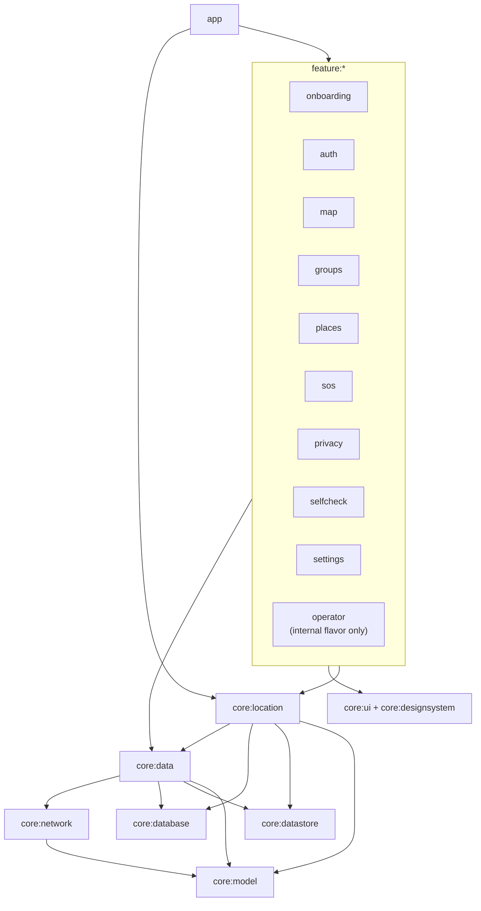
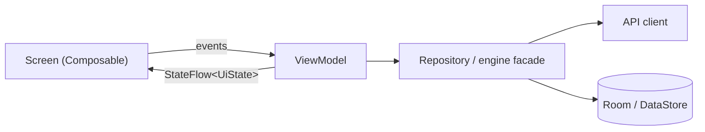
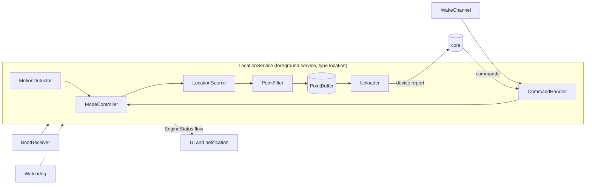
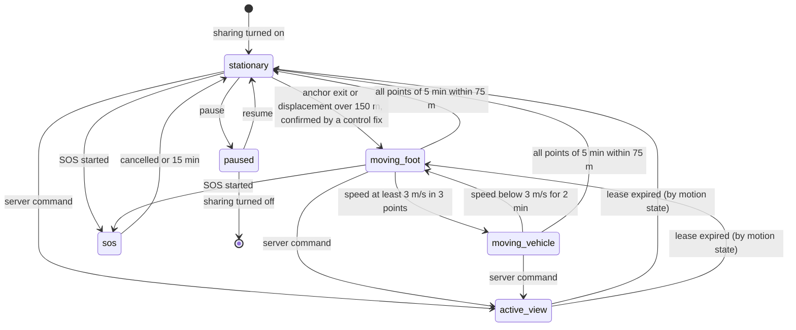

# Android architecture

> Status: draft for blueprint review · Last updated: 2026-11-15
> Related: [overview](overview.md) · [flows](flows.md) · [security](security.md) · [permissions rationale](../privacy/permissions-rationale.md) · [ADR-011](adr/ADR-011-android-stack-and-modules.md) · [ADR-012](adr/ADR-012-always-on-location-foreground-service.md) · [ADR-014](adr/ADR-014-push-as-wake-channel.md) · [ADR-016](adr/ADR-016-operator-capabilities-flavor-and-switch.md)

## 1. Platform and stack

| Item | Choice |
|---|---|
| Platform | Android 10 (API 29) minimum, target API 36; Google Play services required |
| Language and build | Kotlin; Gradle with Kotlin DSL, version catalog (`gradle/libs.versions.toml`), Gradle Wrapper committed |
| UI | Jetpack Compose, Material 3, edge-to-edge |
| Concurrency | Coroutines and Flow |
| Dependency injection | Hilt |
| Network | Ktor Client (OkHttp engine, SSE plugin), kotlinx.serialization |
| Storage | Room (point buffer, cache, engine journal), DataStore (settings, engine state), Android Keystore (token encryption) |
| Background | Foreground service of type `location`; WorkManager only as a watchdog |
| Location | Fused Location Provider, Geofencing API (stationary anchor only) |
| Sign-in | Credential Manager with Sign in with Google |
| Push | Firebase Cloud Messaging |
| Map | MapLibre Native Android; style URL from remote configuration |
| Error reports | Sentry-protocol SDK with a scrubbing filter |

Exact versions are fixed in the version catalog when the project is created. No advertising or analytics SDKs are added, ever (product principle P6).

## 2. Modules

Modules are introduced when the feature that needs them is built; the location spike starts with `app`, `core:location`, `core:network`, `core:database` only.

| Module | Contents |
|---|---|
| `app` | Application class, single activity, navigation host, Hilt wiring, flavors, manifest (service, receivers), notification channels |
| `core:common` | Pure Kotlin used by every module and depending on nothing: `Logger` (one JSON record per line), the scrubbing rules of the log-records contract, the `LogSink` interface (the Android sink lives in `app`) |
| `core:model` | Domain types shared by all modules; names follow the product glossary (`LocationPoint`, `EngineMode`, `Freshness`, `SharingState`, …). Pure Kotlin |
| `core:network` | Ktor client, authentication plugin (token refresh), contract DTOs, problem-details mapping, SSE client |
| `core:database` | Room database: `PointBuffer`, cached groups/members/places, engine journal |
| `core:datastore` | Preferences and engine state; encrypted token store |
| `core:data` | Repositories: the single source of truth for each kind of data, combining network and local storage |
| `core:location` | The location engine (§5), push wake channel, boot and watchdog components |
| `core:designsystem`, `core:ui` | Theme, components, shared composables (status chip, freshness text, member avatar) |
| `core:testing` | Fakes: clock, location source, API server, dispatchers |
| `feature:*` | One module per user-facing area: screens, view models, navigation entries |
| `feature:operator` | Operator disclosure screen and the handler of the operator "turn sharing on" command; **included only in the `internal` flavor** |

Dependency rules: features do not depend on each other; `core:*` never depends on `feature:*`; only `core:data` and `core:location` use `core:network`.

## 3. Build variants

| Dimension | Values | Purpose |
|---|---|---|
| Build type | `debug`, `release` | Standard; `release` is minified with R8 |
| Flavor `distribution` | `internal` | Development and family beta: operator disclosure and capabilities, debug journal screen, configurable server URL |
| | `store` | Google Play: compiled **without** `feature:operator`; no code path can start sharing from a server command; fixed server URL |

The app reports its distribution to the server at sign-in; the server refuses operator actions for `store` devices. A build check verifies that the `store` artifact contains no operator classes ([ADR-016](adr/ADR-016-operator-capabilities-flavor-and-switch.md)).

**Server address per flavor and device.** `store` uses one fixed address (`BuildConfig.SERVER_URL`, a placeholder until production) and has no code path that changes it. `internal` takes the port from the Gradle property `locator.serverPort` (default `8080`; `install-phone.ps1` passes `LOCATOR_HTTP_PORT` from `infra/.env`) and chooses the host at run time from build properties: an emulator uses `http://10.0.2.2:<port>`, a phone uses `http://localhost:<port>` through `adb reverse`. Clear-text HTTP is allowed only in `debug` builds and only for `localhost`, `127.0.0.1` and `10.0.2.2`. The store check is the Gradle task `verifyStoreArtifact` (no `internal` classes in the R8 mapping of `storeRelease`; no location, notification or foreground-service permission in any merged manifest).

## 4. Layers and state

- **Unidirectional data flow.** Each screen has one immutable `UiState` exposed as `StateFlow`; user actions are events handled by the view model. No business rules in composables.
- **Repositories are the source of truth.** Screens observe flows from repositories; repositories decide between cache and network. Use-case classes are added only where logic is shared by several view models.
- **Server decides visibility and freshness.** The app renders what the snapshot and the stream say; it does not recompute freshness thresholds, except for the ticking "N min ago" text derived from server timestamps and the server time offset.
- **Navigation.** Jetpack Navigation for Compose with type-safe routes; one graph in `app`, each feature contributes its destinations. Deep links: invitation links (verified app links on our domain) and notification taps.
- **Process death.** Screen state that matters survives through `SavedStateHandle`; everything else is re-read from repositories.

Top-level destinations: Map (group switcher, member list, member card), Places, SOS (always reachable from the map), Me (sharing state, pause, "Who sees what about me", self-check, settings). Onboarding and sign-in form a separate graph that is shown until complete (US-020 AC5).

## 5. Location engine

The only component that touches location. It runs inside `LocationService`, a foreground service of type `location`, for as long as sharing is active.

| Component | Responsibility |
|---|---|
| `LocationService` | Owns the lifecycle and the persistent notification (state text, "Pause" action). Starts only when preconditions hold (permission, location enabled); otherwise posts a notification and reports the status |
| `ModeController` | State machine over `EngineMode`: stationary, moving on foot, moving in a vehicle, active view, SOS, on request, paused; low battery modifies intervals. The only place that changes location-request parameters. Persists its state |
| `LocationSource` | Interface over Fused Location Provider (a platform `LocationManager` implementation can be added for devices without Google Play services) |
| `MotionDetector` | Stationary anchor geofence, passive updates and displacement between own points; every "maybe moving" signal is confirmed by a control fix before the mode changes |
| `PointFilter` | Drops obvious garbage (no accuracy, stale cache, duplicates, out of order); flags doubtful points (`low_accuracy`, `outlier`, `mock`, `coarse`) and sends them |
| `PointBuffer` | Room table of points not yet confirmed by the server: up to 7 days or 10 000 points *(config)* |
| `Uploader` | Builds device reports: newest point first, then older points in batches of up to 200, gzip; exponential back-off with jitter; deletes points the server accepted |
| `CommandHandler` | Applies commands from report responses and from the wake channel: active-view lease, fresh-location request, refresh configuration, re-register push token; in the `internal` flavor also the operator's "turn sharing on" |
| `WakeChannel` | Interface over push; first implementation is FCM high-priority data messages |
| `BootReceiver` | Restarts the service after reboot and app update when sharing was active; re-registers the anchor geofence |
| `Watchdog` | Periodic WorkManager job: "should be running but is not" → restart where Android allows it, otherwise the notification "Sharing stopped — tap to resume"; uploads the buffer if the service is dead |

Mode parameters (intervals, thresholds, lease lengths) come from the remote configuration with built-in defaults, so they can be tuned after the spike without an app release. Measurable targets are in [nfr.md](../quality/nfr.md).

### 5.1. Modes

All numbers are starting values *(spike)* for the `Balanced` profile; `Economy` and `Frequent` scale the moving intervals and the heartbeat.

| Mode | Entered when | Location request | Upload |
|---|---|---|---|
| `stationary` | No displacement for 5 min | No active request: passive updates + anchor geofence of 150 m; a control fix (balanced power) every 15 min | Heartbeat every 15 min with the control fix and status |
| `moving_foot` | Displacement confirmed, speed below ~3 m/s | High accuracy, every 60 s, minimum displacement 20 m | Each point immediately |
| `moving_vehicle` | Speed ≥ ~3 m/s in three consecutive points | High accuracy, every 30 s | Immediately; in a batch every 60 s on a poor network |
| `active_view` | Server command: a sharing member of the group has the map open, or asked for a fresh location | High accuracy, every 10 s | Each point immediately. Lease of 2 min, renewed while the viewer stays; at most 15 min in a row, then a 5 min cool-down |
| `sos` | The person started SOS | High accuracy, every 5 s | Immediately; first the last known position. 15 min or until cancelled; battery saving ignored |
| `on_request` (store release) | The person chose "Only on request" | As `stationary` but without periodic positions | Heartbeat without coordinates every 30 min; a request grants `active_view` for 2 min |
| `paused` | The person paused | Nothing; the foreground service stops and a quiet ordinary notification "Paused until HH:MM · Resume" replaces the persistent one | The paused status once |
| Low battery (modifier) | Below 15% and not charging | Moving intervals × 2; `active_view` at most 2 min | Heartbeat every 30 min |

Priority of modes: `sos` > `paused` > `active_view` > motion modes. An active-view command received while paused is ignored and the viewer is told "Paused". After process death the engine resumes in the stored mode and takes a control fix first.

### 5.2. Time

Each point carries its age measured on the monotonic clock at the moment of sending; the server computes the position time. Points that survive a reboot lose the monotonic reference and are sent with `timeSource = wall_clock` ([ADR-008](adr/ADR-008-server-computed-time-and-freshness.md)).

### 5.3. Sharing state

The phone is the source of truth for its owner's sharing state (`SharingState`, `Pause`, `SharingMode`, `FrequencyProfile`). Changes are applied locally at once (collection stops immediately on pause), stamped with an increasing revision, and sent to the server by `PATCH /v1/me/sharing`; if that fails, the next device report carries the same state. The server never changes the state by itself. A timed pause ends through two independent signals: a high-priority `pause-ended` push sent by the server at `pause_until` (a high-priority push is one of the allowed background-start exemptions) and the phone's own inexact alarm (an inexact alarm is **not** an exemption, so it can restart the service only when the person granted the battery-optimization exemption) ([background start restrictions](https://developer.android.com/develop/background-work/services/fgs/restrictions-bg-start)). Whichever arrives first resumes sharing; if Android refuses the start, the user gets "Pause ended — tap to resume" (US-022 AC2). Which path works on the test phones is measured in the spike (D-27).

### 5.4. Self-recovery

| Failure | Detected by | Reaction |
|---|---|---|
| Reboot, app update | `BootReceiver` | Start the service (allowed with background permission) |
| Process killed | Sticky service restart; anchor geofence event; server watchdog push; `Watchdog` | Restart where allowed; otherwise a notification the user taps |
| Permission revoked, location turned off | Service start checks, provider-change broadcast | Report status, notify the user, stop the service |
| No network | `Uploader` | Buffer and retry |
| Force stop | Nobody (by design) | The group sees "Offline"; on next launch the app offers to resume |
| App hibernation (months without opening the app) | Prevented, not detected: onboarding and the self-check read `PackageManagerCompat.getUnusedAppRestrictionsStatus()` and offer `IntentCompat.createManageUnusedAppRestrictionsIntent()`; the status is part of the device report | If the person did not turn the restriction off, Android may reset permissions and block jobs, alarms and push ([app hibernation](https://developer.android.com/topic/performance/app-hibernation)); the group sees "No contact"; the next app launch restarts onboarding steps for missing permissions |

The engine journal (ring buffer in Room: mode changes, starts, stops, upload results, no coordinates) feeds the self-check screen and, in the `internal` flavor, a debug screen.

## 6. Push handling

One `FirebaseMessagingService` receives all messages and routes by `type`:

| Message | Priority | Handling |
|---|---|---|
| `locate` (fresh-location request, revival) | High | `WakeChannel` → `CommandHandler`. If the service runs: switch mode. If not: check that the delivered priority is still high, background permission and location are available, then start the service with a visible notification; otherwise show "Open the app to share your location" |
| `locate` (active view) | Normal | If the service runs: switch to `active_view` and show "<name> is viewing the map". If not: nothing (the viewer sees honest freshness). The same command also arrives through the piggyback channel |
| `pause-ended` | High | Resume sharing as after a user tap if the start is allowed; otherwise "Pause ended — tap to resume" |
| `sos` | High | High-importance notification; opening it shows the SOS on the map |
| `place`, `location-request-info` | High | Notification built on the phone from identifiers (names from the local cache or the API) |
| `group-event`, `low-battery`, `no-updates`, `subscription-info` | Normal | Quiet notification |
| `session-revoked`, `config-changed` | Normal | No notification; sign out / refresh configuration |

Push payloads contain a type and identifiers only — never coordinates, names or place names. Texts are built from string resources on the phone, so they follow the app language.

High priority is reserved for messages that end in something the person sees. FCM may downgrade an app's high-priority messages when they often produce no user-visible notification, and always when notifications are not allowed ([FCM message priority](https://firebase.google.com/docs/cloud-messaging/android/message-priority)); a downgraded message cannot start a foreground service. The journal records the requested and the delivered priority of every message (NFR-LOC-10).

Notification channels: `sharing` (persistent, low importance), `requests`, `sos` (high importance), `places`, `group`, `service` ("Sharing stopped", "Pause ended"). The self-check flags a disabled `sos` or `sharing` channel.

## 7. Map and realtime

- The map screen loads the group snapshot over REST, then opens the event stream for the displayed group; while the stream is down it polls the snapshot every 30 s. The stream is open **only while the map is on screen**.
- Events are applied only if newer than what the screen already has (position time for positions, event id for the rest). A `resync` event triggers a snapshot reload; a `reconnect` event triggers a new ticket.
- Markers show the accuracy circle; a position with accuracy worse than 200 m is drawn as a circle without a pin. The map never interpolates between points.
- Opening the map as a sharing viewer makes `delivery` report presence, which the core turns into active-view leases for the group's members.
- The map is drawn with MapLibre Compose 0.20.0 (decided on the walking-skeleton prototype, see [ADR-018](adr/ADR-018-maps-maplibre-openfreemap.md)): `MaplibreMap` with `rememberMapState(baseStyle = BaseStyle.Uri(styleUrl))`; attribution and logo stay at their default places; a style-load failure is reported to the view model, which shows the placeholder. The app declares the OpenGL runtime artifact next to the library. The visual check of map quality for Ukraine is done by the owner in the stage 1 demo.

## 8. Local data and security

| Data | Where | Protection |
|---|---|---|
| Refresh and access tokens | DataStore, encrypted with an AES-GCM key in Android Keystore | Never logged; excluded from backup and device transfer |
| Point buffer | Room | App-private storage; deleted after server confirmation, on sign-out and on account deletion |
| Cached groups, members, places, last snapshot | Room | Cleared on sign-out (US-002 AC2) |
| Engine state and settings | DataStore | — |
| Engine journal | Room, ring buffer | No coordinates |

`allowBackup` is disabled and data-extraction rules exclude everything: location data and tokens must not leave the phone through cloud backup. Network security configuration allows clear-text traffic only in `debug` builds (local server). Release builds are minified; the mapping file is kept for de-obfuscating crash reports.

## 9. Permissions and onboarding

Declared permissions and the texts shown to the user: [permissions-rationale.md](../privacy/permissions-rationale.md). The onboarding graph follows US-020:

1. Age and terms confirmation → sign-in (in the `internal` flavor also the operator disclosure, US-090).
2. Notification permission (Android 13+) with an explanation.
3. **Prominent disclosure** → system dialog for foreground location (precise + approximate requested together).
4. Explanation → system settings for "Allow all the time" (Android 11+; system dialog on Android 10).
5. Recommended, skippable: battery-optimization exemption, turning off the unused-app restrictions, and phone-maker instructions.
6. Result screen: what was granted, what will not work, link to the self-check.

Every step can be skipped; the app then runs in a limited mode and reports it (`SharingLimitation`). Onboarding resumes at the first incomplete step.

## 10. Localization and accessibility

- Default resources are English; `values-uk` holds Ukrainian. The app follows the device language (Ukrainian → Ukrainian, anything else → English) and supports the per-app language setting on Android 13+.
- No user-visible text is hard-coded or sent by the server; adding a language means adding a resource folder.
- Statuses are text or icon plus text, never colour alone; touch targets are at least 48 dp; layouts are checked at 200% font scale; map markers and status chips have content descriptions for TalkBack (US-111).

## 11. Testability

- `ModeController`, `PointFilter`, `Uploader` and `MotionDetector` are plain classes driven by injected clocks, a fake `LocationSource` and a fake API, so the engine's logic is unit-tested on the JVM.
- View models are tested with fake repositories; screens with Compose tests and screenshot tests on the JVM.
- What only real phones can show (phone-maker background killers, Doze, battery) is covered by the [device test matrix](../quality/device-test-matrix.md).
