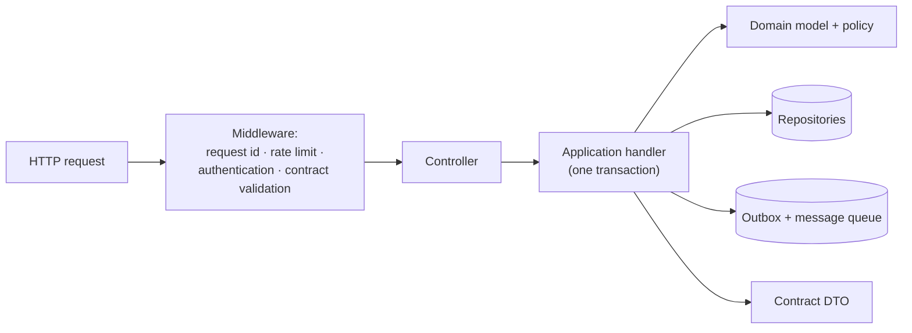

# Backend architecture

> Status: draft for blueprint review · Last updated: 2026-11-15
> Related: [overview](overview.md) · [data model](data-model.md) · [flows](flows.md) · [security](security.md) · [API guide](../api/README.md) · [realtime protocol](../api/realtime-protocol.md) · [ADR index](adr/README.md)

## 1. Services

| Service | Code | Runtime | Public surface |
|---|---|---|---|
| `core` | `backend/core` | PHP 8.5, Symfony (current stable 8.x at project creation), FrankenPHP in classic mode | `/v1/**` REST, `/health`, web pages, `/.well-known/assetlinks.json`; proxies `/v1/stream` to `delivery` and the back-office host to `backoffice` |
| `core-worker` | `backend/core` (same image, different command) | Symfony Messenger consumers + Scheduler | none |
| `delivery` | `backend/delivery` | Go (current stable), single static binary | `/v1/stream` (behind the edge proxy) |
| `backoffice` | `backend/backoffice` | PHP, Laravel + Filament | Separate host name; operator sign-in |

The edge proxy is the Caddy server embedded in FrankenPHP ([ADR-010](adr/ADR-010-frankenphp-runtime-and-edge-proxy.md)): TLS certificates, HTTP/2, routing, response buffering disabled for the stream route. Internal endpoints (`/internal/**`, `/admin/**`) are not routed from the internet.

## 2. Core: module structure

```
backend/core/src/
  Identity/      Groups/      Sharing/      Locations/
  Places/        Alerts/      Admin/        Platform/
```

Every module has the same four layers:

| Layer | Contains | May depend on |
|---|---|---|
| `Domain` | Entities, value objects, domain services, domain events, repository interfaces. Plain PHP, no framework | Own `Domain`, `Platform` kernel types |
| `Application` | Commands, queries and their handlers; transaction boundaries; ports to other modules | Own `Domain`; **published interfaces** of other modules |
| `Infrastructure` | Doctrine mappings and repositories, PostGIS queries, outbox writers, external clients | Own `Domain` and `Application` |
| `Api` | HTTP controllers, request validation, mapping to contract DTOs | Own `Application` |

Rules:

1. A module never reads another module's tables or Doctrine entities. It calls the other module's published interface (`<Module>/Application/Contract/*`) or reacts to its domain events.
2. Dependencies point inward: `Api → Application → Domain`; `Infrastructure` implements interfaces declared by the inner layers.
3. Module boundaries and layer rules are checked automatically in CI by a static dependency checker (tool chosen in the quality stage).
4. Controllers contain no rules; they validate input against the contract, call one handler and map the result.
5. Server code is not generated from the contract; responses are validated against `api/openapi.yaml` in tests ([ADR-009](adr/ADR-009-contract-first-openapi.md)).

### 2.1. Modules, published interfaces and events

| Module | Published interface (examples) | Emits domain events | Reacts to |
|---|---|---|---|
| **Identity** | `CurrentUser`, `UserDirectory.find(ids)`, `DeviceDirectory.activeDevice(userId)` | `UserRegistered`, `DeviceReplaced`, `SessionRevoked`, `AccountDeletionRequested` | — |
| **Groups** | `MembershipQuery.sharedGroups(a, b)`, `.groupsOf(user)`, `.membersOf(group)`, `.roleOf(user, group)` | `MemberJoined`, `MemberLeft`, `MemberRemoved`, `RoleChanged`, `GroupDeleted`, `OwnershipTransferred` | `AccountDeletionRequested` |
| **Sharing** | `VisibilityPolicy`, `SharingQuery.stateOf(user)`, `AccessLog.record(...)` | `SharingStateChanged`, `ConsentWithdrawn` | `MemberJoined` (records consent), `MemberLeft`/`MemberRemoved`/`GroupDeleted` (withdraws consent), `AccountDeletionRequested` |
| **Locations** | `PositionQuery.currentFor(viewer, group)`, `DeviceStatusQuery`, `CommandQueue.enqueue(user, command)` | `PointsAccepted`, `CurrentPositionChanged`, `DeviceStatusChanged`, `FreshnessBecameOffline`, `LocationRequestFulfilled` | `SharingStateChanged`, `AccountDeletionRequested`, `ViewerPresenceChanged` |
| **Places** | `PlaceQuery.placesOf(group)`, `SubscriptionQuery.concerning(user)` | `PlaceTransitionDetected`, `PlaceSubscribed`, `PlaceDeleted` | `PointsAccepted`, `MemberLeft`/`MemberRemoved`, `GroupDeleted`, `SharingStateChanged` |
| **Alerts** | `Notifier.notify(recipients, message)` | `SosStarted`, `SosEnded` | `PlaceTransitionDetected`, `DeviceStatusChanged` (low battery), `FreshnessBecameOffline`, all group events, `PlaceSubscribed`, `LocationRequested` |
| **Admin** | — | `OperatorActionPerformed` | — |
| **Platform** | `Clock`, `IdGenerator`, `Outbox`, `ProblemFactory`, `RateLimiter` | — | — |

Domain events are dispatched **after** the transaction's changes are flushed and **inside** the same database transaction as the message-queue insert, so an event is never lost and never visible before its data.

### 2.2. The visibility policy

One domain service in `Sharing` answers every "may V see M's …" question. No other code implements these checks.

| Question | Granted when |
|---|---|
| `canSeeMember(viewer, subject, group)` | Both are current members of `group` (BR-01) |
| `canSeePosition(viewer, subject, group)` | `canSeeMember` **and** viewer's sharing is active **and** subject's sharing is active (BR-02); or subject has an active SOS (BR-07) |
| `canSeeLastPosition(viewer, subject, group)` | `canSeeMember` **and** viewer's sharing is active (dimmed last position of a paused or silent member, PRD §2.1) |
| `canRequestFreshLocation(viewer, subject, group)` | `canSeePosition` preconditions with the subject not paused; rate limits (BR-12) |
| `receivesPlaceAlerts(viewer, subject, place)` | Subscription exists, both share (US-042 AC3) |
| `operatorMaySee(subject)` | Operator mode on **and** the subject's device runs the `internal` flavor (BR-11) |

"Sharing is active" means state `Active` in mode `Always`, or mode `On request` in the store release. In the MVP one sharing switch covers all groups; the policy already takes the group as a parameter so the per-group switch (v1.1) changes only the policy's data source.

Every query that returns another person's location data takes a `ViewerContext` (who asks, through which group) and passes through the policy; repositories for positions have no "get by user id" method without it. The automated authorization matrix (endpoint × relationship × sharing states) is run against the HTTP API and against the stream.

## 3. Request handling in the core



- **Transactions.** One command = one database transaction. Outbox rows and queued messages are written in the same transaction as the state change.
- **Idempotency.** Point upload is idempotent by point id; SOS start by a client-generated id; other creating commands accept an `Idempotency-Key` header (see the [API guide](../api/README.md)).
- **Concurrency.** The current position is updated with a conditional upsert ("only if newer"), so parallel uploads cannot move a marker backwards (BR-09). Aggregates with competing writers (membership, invitation acceptance) use row locks inside the transaction.
- **Time.** All code takes time from the `Clock` interface (testable). Timestamps are UTC.

## 4. Asynchronous work

### 4.1. Message queue (Symfony Messenger, PostgreSQL transport)

| Queue | Messages | Notes |
|---|---|---|
| `events` | Domain events with asynchronous subscribers: `PointsAccepted` → place evaluation; `PlaceTransitionDetected` → alerts; group events → notifications | Per-user ordering for point events: place evaluation re-reads state under a row lock and ignores points older than the last evaluated one |
| `deletion` | Account deletion steps | Idempotent steps, retried until done |
| `failed` | Messages that exhausted retries | Reported to error tracking; replayed manually |

Retries use exponential back-off. Handlers are idempotent: processing the same message twice has no additional effect.

### 4.2. Scheduled jobs (Symfony Scheduler in `core-worker`)

| Job | Period | What it does |
|---|---|---|
| Heartbeat watchdog | 1 min | Finds devices whose last contact is older than 2 × expected interval → one revival push; older than 4 × → `FreshnessBecameOffline` (no-updates alert, once per episode) |
| Location-request timeout | 15 s | Marks requests without a fresh point after 60 s as timed out and notifies the requester's stream |
| Active-view leases | 30 s | Expires leases, enforces the cap and cool-down |
| Pause timers | 1 min | At `pause_until` sends a high-priority `pause-ended` push to the phone (a background-start exemption); marks the pause as ended on the server ("Pause ended, waiting for an update") if the phone has not resumed by itself |
| SOS timeout | 1 min | Ends SOS episodes older than 15 min *(config)* that the phone did not end |
| Invitation expiry | 1 h | Marks invitations older than 72 h *(config)* as expired |
| Retention cleanup | daily | Deletes points older than each owner's retention (in batches); access-log entries older than 90 days; delivered outbox rows older than 24 h |
| Account purge | daily | Removes remaining records of accounts deleted more than 30 days ago |

## 5. Events to `delivery`: the outbox

[ADR-004](adr/ADR-004-outbox-and-listen-notify.md). The core writes rows to `core.outbox` and issues `NOTIFY outbox, '<id>'` in the same transaction.

| Channel | Event types | Consumer behaviour |
|---|---|---|
| `stream` | `position`, `member`, `group`, `place`, `sos`, `request` | Fan-out to open streams whose ticket entitlements match (group id + class) |
| `control` | `access-changed` (user), `group-closed` | Close affected streams with a `reconnect` event |
| `push` | `push` with target tokens, message type, identifiers, priority, TTL, collapse key | Send through FCM; report dead tokens back to the core |

`delivery` processes rows in id order, keeps its position in `delivery.relay_cursor`, polls every few seconds as a safety net for missed notifications, and on restart continues after the cursor. Delivery is at-least-once; consumers deduplicate by event id.

## 6. `delivery` (Go)

```
backend/delivery/
  cmd/delivery/          entry point, configuration, graceful shutdown
  internal/relay/        LISTEN, outbox reader, cursor
  internal/stream/       SSE handler, hub (groups → connections), replay buffer
  internal/ticket/       stream-ticket verification (public key only)
  internal/presence/     viewers per group, reports to the core
  internal/push/         FCM client, batching, token feedback
  internal/coreclient/   internal REST client
```

Responsibilities and limits:

- **Stream.** Verifies the stream ticket, registers the connection for the ticket's groups and entitlements, sends events and keep-alive comments, replays recent events for `Last-Event-ID`, closes on `control` events and after the maximum stream lifetime (15 min *(config)*). Protocol: [realtime-protocol.md](../api/realtime-protocol.md).
- **Presence.** While at least one viewer has a group's map open, `delivery` reports the set of viewing user ids to the core every 30 s and immediately on change. The core turns presence into active-view leases; `delivery` does not know about leases.
- **Push.** Sends exactly the messages found in `push` outbox rows. It does not choose recipients, texts or priorities.
- **No domain data.** The database role of `delivery` can read `core.outbox` and write `delivery.relay_cursor`, nothing else.
- **Failure mode.** If `delivery` is down, the map falls back to polling the snapshot; pushes queue up in the outbox and are sent after restart if their TTL has not passed.

## 7. Back office (Laravel + Filament)

[ADR-003](adr/ADR-003-backoffice-laravel-separate-context.md). Built in parallel with the family beta and not required to start it; until then the same operations are console commands in the core.

| Function | Data owner |
|---|---|
| Operator accounts, roles, sign-in, audit of operator sessions | `backoffice` schema |
| Remote configuration editor (engine parameters, map style URL, limits), with versions and publish | `backoffice` drafts and history → published version pushed to the core through the admin API |
| Users, groups, device statuses, diagnostics (read-only) | core, through the admin API |
| Operator live map, fresh-location request, remote turn-on (development/beta only) | core, through the admin API; stream from `delivery` with an operator ticket |

Pages that show core data are custom Filament pages backed by an API client, not Eloquent resources.

### 7.1. Admin API

`/admin/v1/**` in the core, reachable only on the internal network, authenticated by a short-lived service token signed by the back office that carries the operator's id.

| Scope | Examples | Available when |
|---|---|---|
| `admin:service` | Publish remote configuration; service statistics without coordinates; list users and groups without location data; block an abusive account | Always |
| `admin:operator` | See positions and history; request a fresh location; turn sharing on remotely; operator stream ticket | Only while operator mode is on (BR-11), and only for subjects on the `internal` flavor |

Every explicit `admin:operator` action (fresh-location request, remote turn-on, history view) writes an access-log entry for each affected person and triggers the phone notification required by BR-04. The passive live overview writes one access-log entry per person per day while an operator stream is open, without a notification. Console commands of the core offer the same operator actions before the back office exists and follow the same rules. The admin API gets its own contract file when the back office is built.

## 8. Configuration

Twelve-factor: all configuration comes from environment variables; `.env.example` is committed, real values are not.

| Group | Examples |
|---|---|
| Deployment | Public base URL, environment name, log level |
| Secrets | Database credentials per role, token signing keys, stream-ticket signing key, internal API secret, FCM service-account key, error-tracking DSN |
| Switches | `OPERATOR_MODE` (`off` by default), test identity provider (never enabled in production images) |
| Product defaults *(config)* | Limits of BR-12, retention, alert thresholds, SOS duration, rate limits |

Product defaults that must change without a deployment (engine parameters, map style URL) belong to the **remote configuration**: a versioned document published by the operator, stored by the core and served to phones by `GET /v1/config`.

## 9. Errors

- One error format for all services: `application/problem+json` (RFC 9457) with a stable machine-readable `code` and a `requestId`. Codes are listed in the [API guide](../api/README.md).
- Domain errors are typed exceptions mapped to problems in one place. Unknown exceptions become `500 internal_error` without details.
- Authorization failures for other people's data return `404` (not `403`) when revealing existence would leak membership.
- Validation errors list offending fields in `errors[]`.

## 10. Logging and observability

- Structured JSON logs to stdout in every service (Monolog, `log/slog`), with `requestId` propagated from the edge proxy through the core, the outbox event and `delivery`.
- Log fields are allow-listed. Coordinates, place names, tokens, e-mail addresses and invitation codes are never logged above debug level; debug level is disabled in production.
- Error tracking uses the Sentry protocol with a scrubbing filter in each SDK (tested).
- `/health` on every service: liveness (process up) and readiness (database reachable, for `delivery` also the outbox listener). Health responses contain no data.
- Service statistics for the operator are counts and durations only (reports per hour, stream connections, push success rate), never coordinates.

## 11. Testing seams

Detailed strategy: [testing strategy](../quality/testing-strategy.md). The architecture provides:

- Pure domain layer → fast unit tests for the visibility policy, freshness, place hysteresis, role rules.
- `Clock`, `IdGenerator`, push sender, identity verifier behind interfaces → deterministic tests.
- **Test identity provider** that issues sessions for scripted users. It is a separate bundle that is not installed in production images; a test asserts its routes are absent there.
- The authorization matrix as a first-class test suite that blocks merging when it fails.

## 12. Growth path

Each step is taken only when a measured limit is reached, through a new ADR.

1. Database on its own host or a managed PostgreSQL.
2. Several `core` and `delivery` instances behind a load balancer (`delivery` needs either sticky fan-out per group or a broker).
3. A broker instead of `LISTEN/NOTIFY` when more than one `delivery` instance must receive every event.
4. Point ingestion split from the rest of the core if upload traffic dominates.
5. History table partitioned by day when retention deletes or history queries become measurably slow ([ADR-007](adr/ADR-007-postgresql-postgis-storage.md)).
