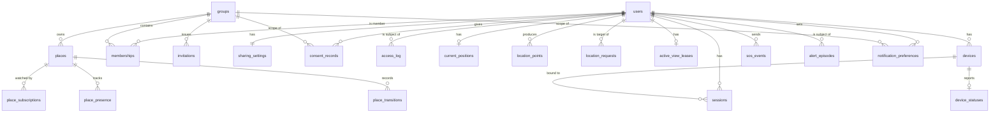

# Data model

> Status: draft for blueprint review · Last updated: 2026-11-15
> Related: [overview](overview.md) · [backend](backend.md) · [security](security.md) · [data inventory](../privacy/data-inventory.md) · [ADR-007](adr/ADR-007-postgresql-postgis-storage.md) · [ADR-008](adr/ADR-008-server-computed-time-and-freshness.md)

## 1. Conventions

- **Database:** PostgreSQL 18 with PostGIS 3.6. One database, three schemas: `core`, `delivery`, `backoffice`.
- **Ownership:** each schema has one owning service and one database role; no cross-schema foreign keys.

| Role | Rights |
|---|---|
| `core_app` | Read/write on schema `core` |
| `core_migrator` | DDL on schema `core` (used only by migrations) |
| `delivery_app` | `SELECT` on `core.outbox`; read/write on schema `delivery` |
| `backoffice_app` | Read/write on schema `backoffice`; no rights on `core` |

- **Identifiers:** `uuid` everywhere. Server-generated ids are time-ordered UUIDs (version 7) created by the application; point ids are generated on the phone.
- **Time:** `timestamptz`, stored in UTC. Columns ending in `_at` are instants; durations end in `_s` or `_ms`.
- **Coordinates:** `geography(Point, 4326)`; distances are in metres.
- **Naming:** tables in plural `snake_case`; the API uses `camelCase` for the same fields.
- **Deletion:** rows are deleted physically. Soft deletion is used only for the 30-day account purge window (`users.deletion_requested_at`).
- **Migrations:** Doctrine Migrations for `core`, Laravel migrations for `backoffice`, plain SQL for `delivery`. Migrations run as a separate step before a new version starts.
- Numbers marked *(config)* are configuration defaults.

## 2. Entity-relationship diagram (schema `core`)

## 3. Tables by module

### 3.1. Identity

**`users`**

| Column | Type | Notes |
|---|---|---|
| `id` | uuid PK | |
| `google_sub` | text, unique | Stable Google account identifier; never exposed by the API |
| `email` | text | From the ID token; used for account recovery questions and web deletion; not shown to other members |
| `display_name` | text | From the Google profile |
| `photo_url` | text null | From the Google profile |
| `locale` | text | `uk` or `en`; last reported by the app |
| `age_confirmed_at` | timestamptz | US-007 |
| `terms_version`, `terms_accepted_at` | text, timestamptz | US-007 |
| `status` | text | `active`, `blocked`, `deletion_pending` |
| `deletion_requested_at` | timestamptz null | Start of the 30-day purge window |
| `created_at` | timestamptz | |

**`devices`** — one active device per account (BR-10).

| Column | Type | Notes |
|---|---|---|
| `id` | uuid PK | |
| `user_id` | uuid FK → users | |
| `installation_id` | uuid | Generated by the app at first start; not a hardware identifier |
| `distribution` | text | `internal` or `store` (build flavor) |
| `manufacturer`, `model`, `os_version`, `app_version` | text | For phone-maker instructions and diagnostics |
| `push_token` | text null | FCM registration token |
| `push_token_updated_at` | timestamptz null | |
| `created_at`, `revoked_at` | timestamptz | `revoked_at` set when replaced or signed out |

Constraints: unique partial index on `(user_id) WHERE revoked_at IS NULL`. Revoked devices are deleted after 30 days.

**`sessions`** — refresh-token families ([ADR-015](adr/ADR-015-authentication-and-sessions.md)).

| Column | Type | Notes |
|---|---|---|
| `id` | uuid PK | Session id (`sid` claim of the access token) |
| `user_id`, `device_id` | uuid FK | |
| `refresh_token_hash` | bytea | SHA-256 of the current refresh token |
| `previous_token_hash` | bytea null | Detects reuse of a rotated token |
| `expires_at` | timestamptz | Sliding, 60 days *(config)* |
| `last_used_at`, `created_at`, `revoked_at` | timestamptz | |
| `revoke_reason` | text null | `sign_out`, `new_device`, `reuse_detected`, `account_deleted`, `operator` |

### 3.2. Groups

**`groups`**: `id`, `name` (1–40 characters), `created_by`, `created_at`.

**`memberships`**

| Column | Type | Notes |
|---|---|---|
| `id` | uuid PK | |
| `group_id`, `user_id` | uuid FK | Unique `(group_id, user_id)` |
| `role` | text | `owner`, `admin`, `member` |
| `joined_at` | timestamptz | Used for ownership succession (US-005 AC3) |
| `invited_by` | uuid null | |

Constraints: unique partial index on `(group_id) WHERE role = 'owner'`. Limits of BR-12 (20 members per group, 10 groups per user) are checked in the domain under a row lock on the group / user.

**`invitations`**

| Column | Type | Notes |
|---|---|---|
| `id` | uuid PK | |
| `group_id`, `created_by` | uuid FK | |
| `code` | text, unique | 8 characters from an unambiguous alphabet (40 bits); also the link suffix |
| `status` | text | `pending`, `accepted`, `declined`, `revoked`, `expired` |
| `expires_at` | timestamptz | 72 h *(config)* |
| `used_by`, `used_at` | uuid null, timestamptz null | |
| `created_at` | timestamptz | |

Finished invitations are deleted after 30 days.

### 3.3. Sharing

**`sharing_settings`** — one row per user; mirrors the phone's state.

| Column | Type | Notes |
|---|---|---|
| `user_id` | uuid PK | |
| `state` | text | `not_started`, `active`, `paused` |
| `mode` | text | `always`, `on_request` (store release) |
| `profile` | text | `economy`, `balanced`, `frequent` |
| `paused_at`, `pause_until` | timestamptz null | `pause_until` null = until resumed |
| `pause_ended_at` | timestamptz null | Timed pause ended but the phone has not resumed yet |
| `rev` | bigint | Change counter set by the phone; the server applies a change only with a higher `rev` |
| `changed_by` | text | `self`, `operator` |
| `updated_at` | timestamptz | |

The per-group switch (v1.1) adds `group_sharing_overrides (user_id, group_id, state, …)` without changing this table.

**`consent_records`** — evidence of consent and its withdrawal.

| Column | Type | Notes |
|---|---|---|
| `id` | uuid PK | |
| `user_id`, `group_id` | uuid | `group_id` null for account-wide consents |
| `kind` | text | `share_location`, `operator_disclosure`, `terms`; later `share_history` |
| `text_version` | text | Version of the text the person saw |
| `granted_at`, `withdrawn_at` | timestamptz | |
| `withdrawn_by` | text null | `leave`, `removed`, `group_deleted`, `account_deleted` |

Kept until account deletion + 30 days.

**`access_log`** — BR-04, US-071.

| Column | Type | Notes |
|---|---|---|
| `id` | uuid PK | Time-ordered; used as the pagination cursor |
| `subject_user_id` | uuid | Whose data was accessed |
| `actor_kind` | text | `member`, `operator`, `system` |
| `actor_user_id` | uuid null | Member id; null for operator/system |
| `actor_label` | text null | Operator display label |
| `action` | text | `location_requested`, `operator_viewed_live` (passive overview, at most one entry per person per day, no phone notification — BR-04), `operator_viewed_position`, `operator_viewed_history`, `operator_requested_location`, `sharing_turned_on_remotely`, `revival_push_sent` |
| `group_id` | uuid null | |
| `outcome` | text null | `fulfilled`, `timed_out`, `rejected_paused`, … |
| `created_at` | timestamptz | Index `(subject_user_id, created_at desc)` |

Contains no coordinates. Entries older than 90 days *(config)* are deleted daily.

### 3.4. Locations

**`current_positions`** — the live marker; one row per user.

| Column | Type | Notes |
|---|---|---|
| `user_id` | uuid PK | |
| `device_id`, `point_id` | uuid | |
| `geog` | geography(Point, 4326) | |
| `accuracy_m` | real | |
| `altitude_m`, `speed_mps`, `bearing_deg` | real null | |
| `fixed_at` | timestamptz | Position time (BR-06) |
| `received_at` | timestamptz | |
| `flags` | text[] | `low_accuracy`, `mock`, `coarse`, `on_demand` |

Written by a conditional upsert: `ON CONFLICT (user_id) DO UPDATE … WHERE excluded.fixed_at > current_positions.fixed_at` (BR-09). Points flagged `outlier` never become the current position.

**`device_statuses`** — what the phone last reported about itself; one row per active device.

| Column | Type | Notes |
|---|---|---|
| `device_id` | uuid PK | |
| `user_id` | uuid | |
| `last_seen_at` | timestamptz | Last contact (any report) |
| `next_report_in_s` | integer | Expected interval announced by the phone |
| `engine_mode` | text | `stationary`, `moving_foot`, `moving_vehicle`, `active_view`, `sos`, `on_request`, `paused` |
| `battery_pct` | smallint null | |
| `charging` | boolean null | |
| `location_enabled` | boolean | Location services on the device |
| `permission` | text | `none`, `foreground`, `background` |
| `precision` | text | `precise`, `approximate` |
| `power_saving`, `battery_optimization_exempt` | boolean | |
| `self_check` | jsonb | Summary of the reliability self-check (US-072 AC4); statuses only |
| `freshness_offline_since` | timestamptz null | Set by the watchdog; drives the once-per-episode alert |
| `revival_push_sent_at` | timestamptz null | One revival push per silence episode |
| `updated_at` | timestamptz | |

Freshness (BR-08) is **not stored**; it is computed when read from `last_seen_at`, `next_report_in_s` and the current position's `fixed_at`:

| Freshness | Condition |
|---|---|
| `live` | `now − fixed_at ≤ 2 min` |
| `recent` | `now − last_seen_at ≤ 1.5 × next_report_in_s` |
| `stale` | between 1.5 × and 4 × |
| `offline` | beyond 4 × |

**`location_points`** — history; one ordinary table.

| Column | Type | Notes |
|---|---|---|
| `user_id`, `device_id` | uuid | |
| `point_id` | uuid | Generated on the phone |
| `seq` | bigint | Monotonic counter of the device; gaps are diagnostics |
| `geog` | geography(Point, 4326) | |
| `accuracy_m` | real | |
| `altitude_m`, `speed_mps`, `bearing_deg` | real null | |
| `fixed_at` | timestamptz | Position time computed by the server |
| `device_time` | timestamptz | Phone wall clock, kept for diagnostics and export |
| `received_at` | timestamptz | |
| `time_source` | text | `monotonic`, `wall_clock` |
| `engine_mode` | text | |
| `battery_pct`, `charging` | smallint null, boolean null | |
| `flags` | text[] | |

- Primary key `(device_id, point_id)` — the idempotency key: upload inserts with `ON CONFLICT DO NOTHING`, so a re-sent batch stores nothing twice even though a re-sent point gets a slightly different `fixed_at`.
- Index `(user_id, fixed_at desc)` for the current-position fallback, history and retention.
- Points whose `fixed_at` is older than the maximum retention are rejected at upload (`too_old`).
- Not partitioned: about 1 million rows for 100 people × 30 days ([§5](#5-volume-estimate)) is small for PostgreSQL. Retention deletes rows in batches. Daily partitioning is the growth step when deletes or history queries become measurably slow; it would need a separate idempotency table, because a unique key on a partitioned table must include the partition key ([ADR-007](adr/ADR-007-postgresql-postgis-storage.md)).

**`location_requests`** — fresh-location requests (US-028, US-092).

| Column | Type | Notes |
|---|---|---|
| `id` | uuid PK | |
| `requester_kind`, `requester_user_id` | text, uuid null | `member` or `operator` |
| `target_user_id`, `group_id` | uuid, uuid null | |
| `status` | text | `pending`, `fulfilled`, `timed_out` |
| `created_at`, `resolved_at` | timestamptz | Timeout 60 s |
| `fulfilled_point_id` | uuid null | |

Also the source for the rate limit "10 requests per requester per target per hour". Deleted after 7 days; the lasting record is the access log.

**`active_view_leases`**: `target_user_id` PK, `started_at`, `expires_at`, `cooldown_until`, `viewer_user_ids uuid[]`. One row per target while someone watches; enforces the 2-minute lease, the 15-minute cap and the 5-minute cool-down *(spike)*.

**`pending_commands`**: `id`, `user_id`, `type`, `payload jsonb`, `created_at`, `expires_at`, `delivered_at`. Commands waiting for the phone's next report (piggyback channel). Expired or delivered rows are deleted.

**`remote_config_versions`**: `version` (integer PK), `payload jsonb`, `published_at`, `published_by`. The latest row is served by `GET /v1/config`; older rows are history for rollback.

**`retention_overrides`** (v1.1): `user_id` PK, `days`. In the MVP every user has the default (30 days).

### 3.5. Places

**`places`**: `id`, `group_id`, `name` (1–40), `center geography(Point, 4326)`, `radius_m` (100–1000), `created_by`, `created_at`, `updated_at`. GiST index on `center` is not needed at this size: a group has at most 20 places.

**`place_subscriptions`**: `id`, `place_id`, `user_id` (unique pair), `on_arrival`, `on_departure`, `muted_member_ids uuid[]`, `created_at`.

**`place_presence`** — hysteresis state per member and place.

| Column | Type | Notes |
|---|---|---|
| `place_id`, `user_id` | uuid | Primary key |
| `state` | text | `unknown`, `inside`, `outside` |
| `state_since` | timestamptz | |
| `candidate_state` | text null | State suggested by recent points but not confirmed yet |
| `candidate_since`, `candidate_points` | timestamptz null, smallint | |
| `last_point_at` | timestamptz | Points older than this are ignored |

**`place_transitions`**: `id`, `place_id`, `group_id`, `user_id`, `kind` (`arrival`, `departure`), `occurred_at` (estimated crossing time), `detected_at`, `point_id`. Location-derived data: deleted with the same retention as points.

Starting rule for transitions *(spike; refined in the places specification)*:

1. Points with accuracy worse than `max(100 m, radius / 2)` and points flagged `outlier` or `mock` are ignored.
2. A point suggests `inside` when its distance to the centre is ≤ radius, and `outside` when the distance is > radius + `max(50 m, accuracy)`. Anything in between changes nothing.
3. A suggested state different from the current one becomes confirmed after two consecutive points, or one point and 60 s without contradiction.
4. The crossing time is the `fixed_at` of the first confirming point. The first confirmed state after `unknown` produces no alert.
5. Late points from the offline buffer (older than `last_point_at`) are ignored.

### 3.6. Alerts

**`sos_events`**

| Column | Type | Notes |
|---|---|---|
| `id` | uuid PK | Generated on the phone (idempotent start) |
| `user_id` | uuid | Unique partial index: one active SOS per user |
| `started_at`, `ended_at` | timestamptz | |
| `end_reason` | text null | `cancelled`, `safe`, `timeout` |

Deleted with the same retention as points.

**`alert_episodes`**: `id`, `kind` (`low_battery`, `no_updates`), `subject_user_id`, `started_at`, `ended_at`. Unique partial index on `(kind, subject_user_id) WHERE ended_at IS NULL` gives "once per episode".

**`notification_preferences`**: primary key `(user_id, group_id)`; `low_battery`, `no_updates`, `membership_events` booleans (default true).

There is no notification inbox table in the MVP: alerts are push messages; the state they refer to (active SOS, group members, places) is always available from the API.

### 3.7. Platform

**`outbox`** ([ADR-004](adr/ADR-004-outbox-and-listen-notify.md))

| Column | Type | Notes |
|---|---|---|
| `id` | bigint identity PK | Order of delivery; also the stream event id |
| `channel` | text | `stream`, `control`, `push` |
| `type` | text | See the [realtime protocol](../api/realtime-protocol.md) |
| `group_id`, `user_id` | uuid null | Audience |
| `class` | text null | `status`, `position`, `sos` — matched against ticket entitlements |
| `payload` | jsonb | Already filtered by the core |
| `expires_at` | timestamptz null | For push |
| `created_at` | timestamptz | |

Rows older than 24 h are deleted daily.

**`messenger_messages`** — Symfony Messenger queue table (managed by the framework).

**`rate_limits`** — counters for the rate limiter (key, window, hits, expires). Unlogged table: losing it on a crash is acceptable.

### 3.8. Other schemas

- **`delivery.relay_cursor`**: `name` PK, `last_outbox_id`, `updated_at`.
- **`backoffice`**: operator accounts and roles, configuration drafts and publication history, operator session audit, framework tables. Designed when the back office is built; it never stores positions.

## 4. Retention and deletion

| Data | Kept for | Mechanism |
|---|---|---|
| Current position | Until replaced, or until account deletion | Upsert; deleted with the account |
| History points | Owner's retention, 30 days by default *(config)*; hard maximum *(config)* | Daily: delete rows older than each owner's retention, in batches |
| Place transitions, SOS events | Same as points | Daily delete |
| Location requests | 7 days | Daily delete |
| Access log | 90 days *(config)* | Daily delete |
| Outbox | 24 h | Daily delete |
| Sessions | Until expiry or revocation + 30 days | Daily delete |
| Finished invitations | 30 days | Daily delete |
| Consent records | Account lifetime + 30 days | Account purge |
| Backups | 7 daily + 4 weekly, encrypted | Rotation; stated in the privacy policy |

**Leaving a group / removal:** membership row deleted; consent record closed; the leaver's place subscriptions in that group deleted; `place_presence` rows for that group deleted; open streams closed through a `control` event.

**Account deletion (US-005):**

| When | What |
|---|---|
| Immediately, in the request | All sessions revoked; sharing state set to stopped; `users.status = deletion_pending`; memberships removed (ownership passed on or group deleted); outbox events so that members see the person disappear |
| Within minutes (worker) | `current_positions`, all `location_points`, `place_presence`, `place_transitions`, `sos_events`, `location_requests`, leases and pending commands of the user deleted; push token removed |
| Within 30 days (purge job) | `users` row, devices, consent records and access log of the user deleted; access-log entries where the user was the **actor** keep the entry but lose the actor reference |
| Backups | Age out within the backup retention period |

## 5. Volume estimate

Assumptions *(to be measured)*: about 300 points per person per day; 100 people; 30 days.

| Table | Rows | Size with indexes |
|---|---|---|
| `location_points` | ~0.9 million | ~300 MB |
| `outbox` (24 h) | ~40 thousand | ~20 MB |
| Everything else | thousands | < 10 MB |

At 1000 people the same model gives ~3 GB of history, still comfortable for one PostgreSQL instance.

## 6. Open points for the feature specifications

- Exact hysteresis parameters for places (after the spike).
- Whether `device_statuses.self_check` needs history for diagnostics (currently only the latest summary is kept).
- History tables for v1.1 (`history_shares`, stop detection results) are designed in the history specification.
