# Key flows

> Status: draft for blueprint review · Last updated: 2026-11-15
> Related: [overview](overview.md) · [Android](android.md) · [backend](backend.md) · [data model](data-model.md) · [security](security.md) · [API guide](../api/README.md) · [realtime protocol](../api/realtime-protocol.md)

Sequence diagrams for the paths that carry the product's promises. Endpoint names match `api/openapi.yaml`. Participants: **App** (UI), **Engine** (location engine inside the app), **core**, **worker** (`core-worker`), **delivery**, **DB**, **FCM**, **Google**.

| # | Flow | Stories |
|---|---|---|
| 1 | Onboarding and permissions | US-007, US-020, US-090 |
| 2 | Sign-in and session | US-001, US-003, US-004 |
| 3 | Invitation | US-011, US-012 |
| 4 | Device report (point upload) | US-024, US-026 |
| 5 | Offline buffer and resend | US-026 |
| 6 | Live map: snapshot, stream, active view | US-028 AC1, US-030 |
| 7 | Fresh-location request | US-028 AC2–AC4 |
| 8 | Pause and resume | US-021, US-022, US-023 |
| 9 | Place transition and alert | US-042 |
| 10 | SOS | US-050–US-052 |
| 11 | Leaving or removal: access revocation | US-015, US-016 |
| 12 | Silence: watchdog, revival, no-updates alert | US-024 AC4, US-061 |
| 13 | Account deletion | US-005 |
| 14 | Operator action (development/beta) | US-091–US-093 |

---

## 1. Onboarding and permissions

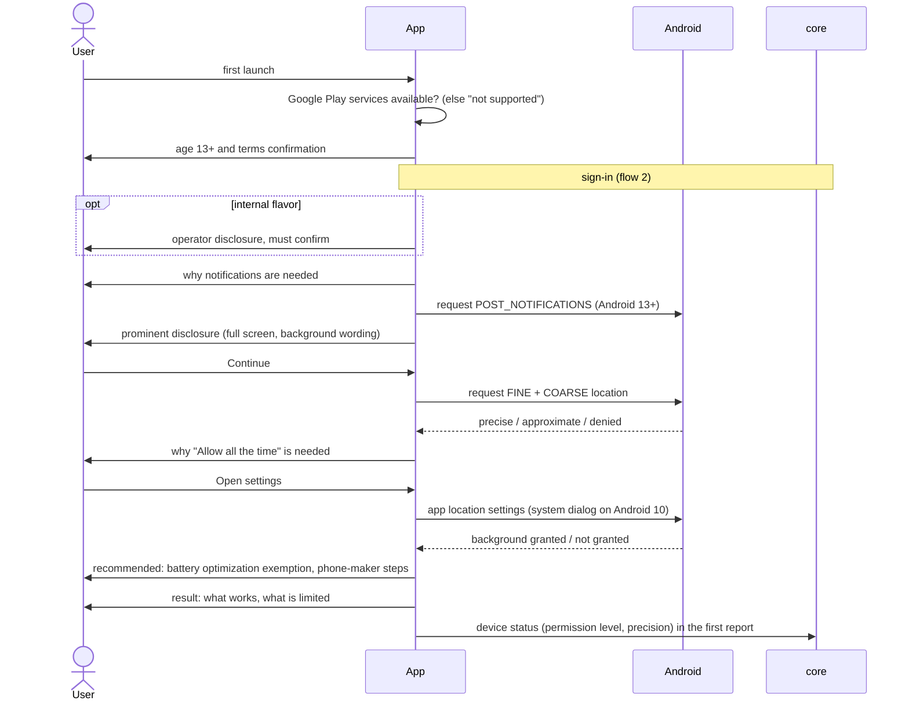

Rules: the system dialog appears only after the user's explicit action on the disclosure screen; leaving the screen is not consent; no location is read before step "request FINE + COARSE". Each step may be skipped; the result screen and the self-check name the consequences.

## 2. Sign-in and session

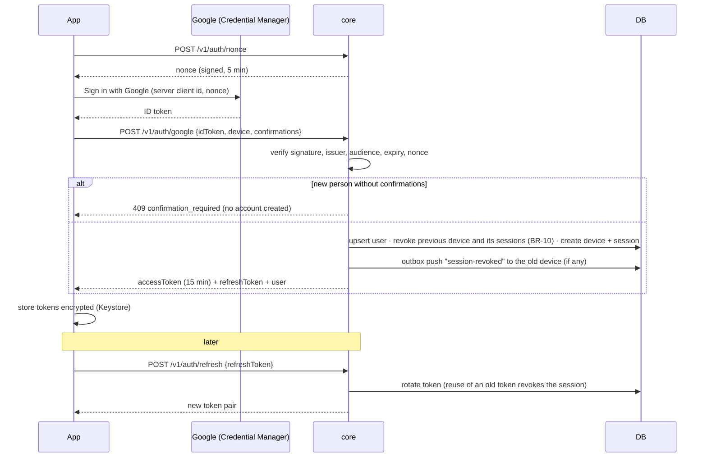

The old phone learns about the replacement from the push or from the next `401 session_revoked`; it stops sharing, clears local data and shows "Signed in on another device" (US-004 AC2).

## 3. Invitation

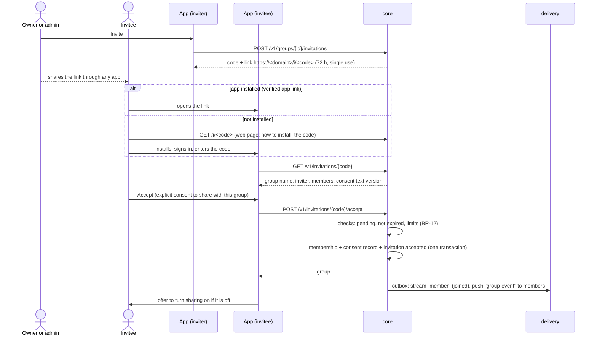

Attempts with wrong codes are rate-limited per account and per IP address. An expired, used or revoked code returns `410 invitation_unavailable` and changes nothing.

## 4. Device report (point upload)

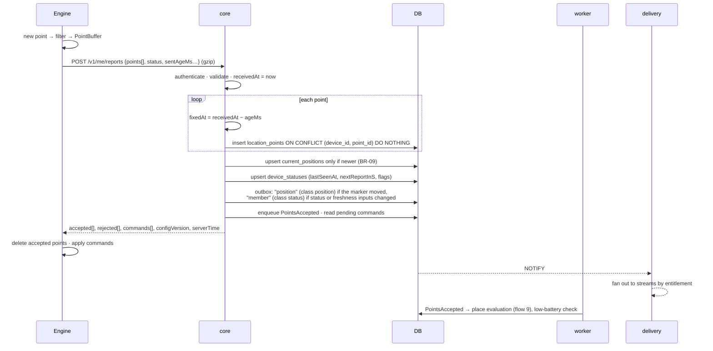

Notes:

- The whole request is one transaction; a retry of the same batch returns the same `accepted` list and stores nothing twice.
- A report with no points is a heartbeat: only the status is updated.
- When sharing is paused or not started the server accepts no points recorded **after** the pause began (`rejected: not_sharing`), except during an active SOS (BR-07). Points recorded while sharing was still on (`fixedAt < paused_at`, for example buffered offline before the pause) are accepted into history; they never move the live marker of a paused person.
- The response is the piggyback channel for commands; it works without push.

## 5. Offline buffer and resend

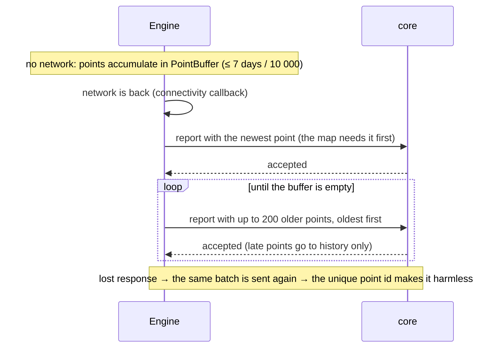

Back-off: 5 s, 10 s, 20 s … up to 5 min with jitter; reset when connectivity returns. `4xx` other than `401`/`429` quarantines the batch and records it in the engine journal so one bad batch does not block the queue. Points older than the retention maximum are rejected as `too_old` and dropped by the phone.

## 6. Live map: snapshot, stream, active view

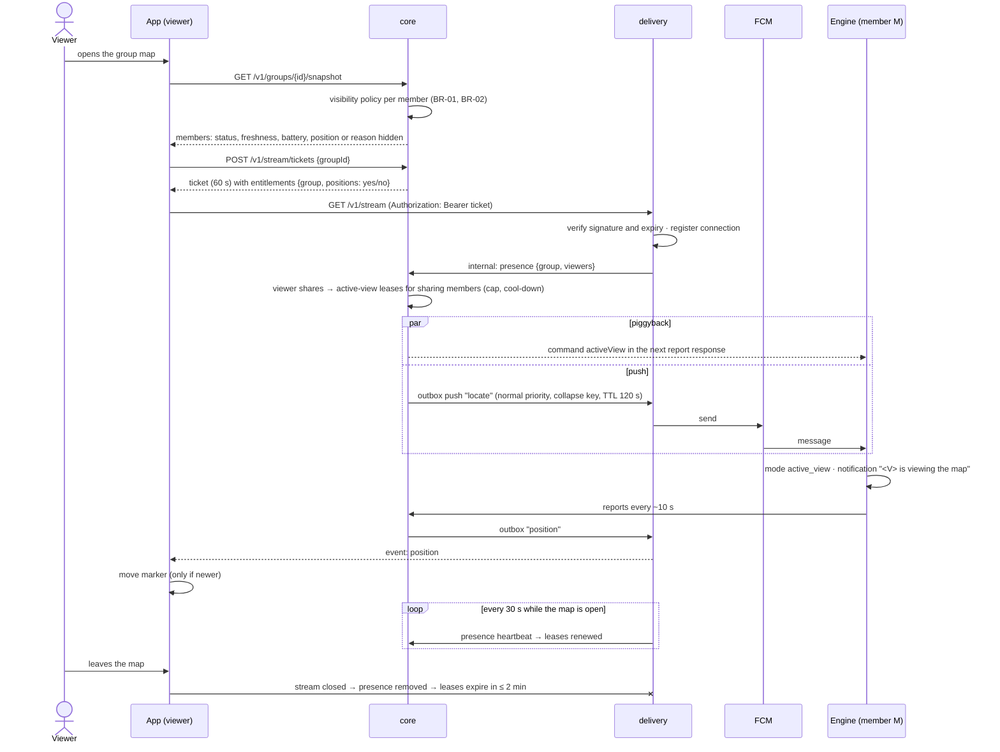

If the stream cannot be opened or breaks, the app polls the snapshot every 30 s and keeps trying to reconnect. A viewer who is not sharing gets a ticket without the position entitlement and a snapshot without positions; no leases are created for them (reciprocity).

Active view uses **normal** priority on purpose: it only changes the text of an already visible notification, and FCM may downgrade an app's high-priority messages when they often end without a user-visible notification ([FCM message priority](https://firebase.google.com/docs/cloud-messaging/android/message-priority)). High priority is kept for the explicit request (flow 7), SOS, place alerts, revival (flow 12) and the end of a pause (flow 8). A stationary member whose phone sleeps may therefore join the active view only at the next heartbeat; the map shows the honest position age meanwhile. The spike measures this choice (NFR-LOC-10).

## 7. Fresh-location request

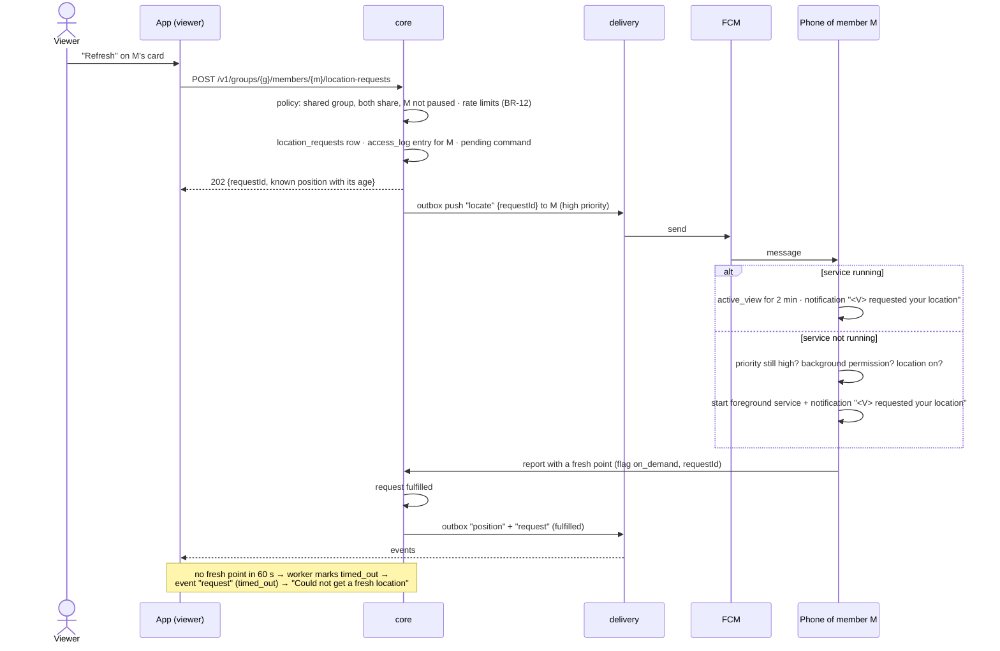

Rejections are immediate and explicit: `409 target_paused`, `409 viewer_not_sharing`, `429 rate_limited`. If the phone cannot start the service (priority downgraded, permission missing) it shows "Open the app to share your location" and reports the reason in its next status.

## 8. Pause and resume

```mermaid
sequenceDiagram
  actor U as User
  participant A as App / Engine
  participant C as core
  participant D as delivery
  U->>A: Pause (1 h / until a time / until I resume) — app or notification
  A->>A: stop collection now · rev + 1 · service stops ·<br/>quiet notification "Paused until … · Resume" · schedule end-of-pause alarm
  A->>C: PATCH /v1/me/sharing {state: paused, pauseUntil, rev}
  C->>C: apply if rev is higher · cancel leases and pending requests for U
  C->>D: outbox: "member" (paused since/until) to U's groups,<br/>control "access-changed" for U
  D-->>D: close U's streams with "reconnect" (U loses position entitlement)
  Note over A,C: PATCH failed → retried; the next report carries the same state
  Note over C: worker at pause_until
  C->>D: outbox push "pause-ended" to U (high priority)
  D->>A: via FCM
  alt push or alarm arrives and Android allows the start
    A->>A: start service (first of: high-priority push, inexact alarm)
    A->>C: PATCH {state: active, rev} · first report
  else start not allowed (priority downgraded, no exemption)
    A->>U: notification "Pause ended — tap to resume"
    C->>C: worker: pause_until passed → "Pause ended, waiting for an update"
  end
```

Two signals end a timed pause. The server's high-priority `pause-ended` push is an allowed background-start exemption ([background start restrictions](https://developer.android.com/develop/background-work/services/fgs/restrictions-bg-start)); the action was scheduled by the person, and the result is visible (the persistent notification returns). The phone's own inexact alarm is a fallback without the network, but an inexact alarm is not an exemption: it can restart the service only when the person exempted the app from battery optimization. Exact alarms need a special permission that the app does not request. If neither path is allowed, the notification path is used. The spike measures each path on the test phones (D-27); the pause specification makes the final choice.

While paused: others see "Paused since/until …" and the dimmed last position; U sees names and statuses but no positions, gets no place alerts and cannot request fresh locations; SOS still works in both directions.

## 9. Place transition and alert

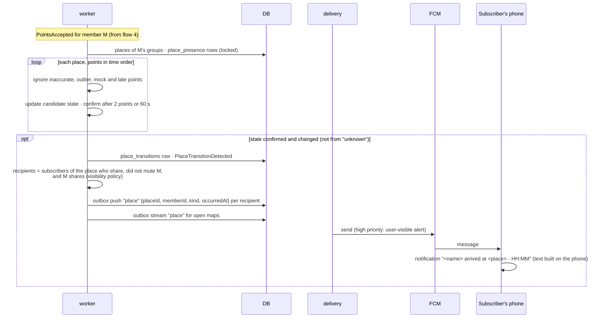

Places are evaluated only on the server, from points the server already receives ([ADR-013](adr/ADR-013-places-evaluated-on-server.md)). Consequences: the delay equals the upload interval; nothing is detected while the member is paused or offline; an edit of a place takes effect immediately and resets its presence rows to `unknown`.

## 10. SOS

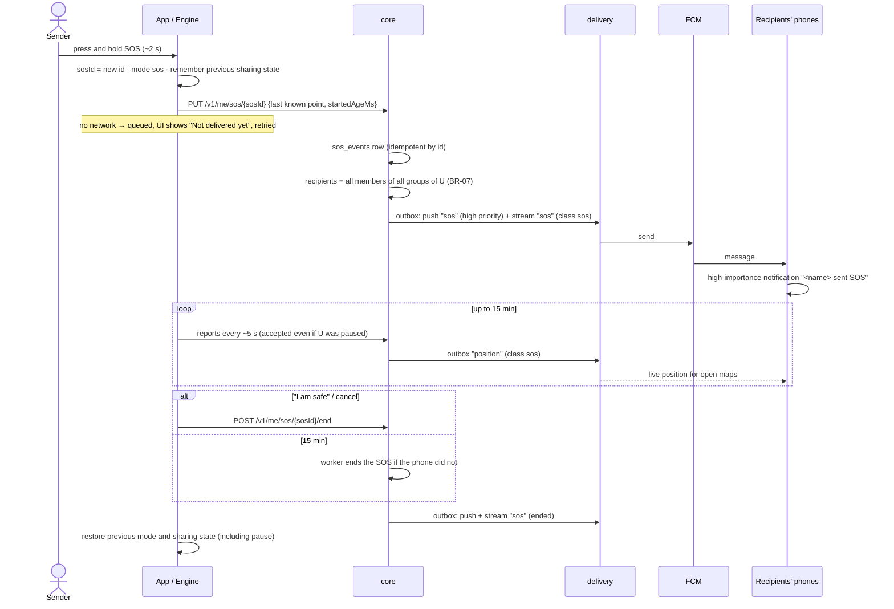

During an SOS the sender's positions carry class `sos`, which every member's ticket includes regardless of reciprocity. Recipients open the SOS with `GET /v1/sos/active`. The SOS screen always offers "Call 112", which opens the dialer and needs no permission.

## 11. Leaving or removal: access revocation

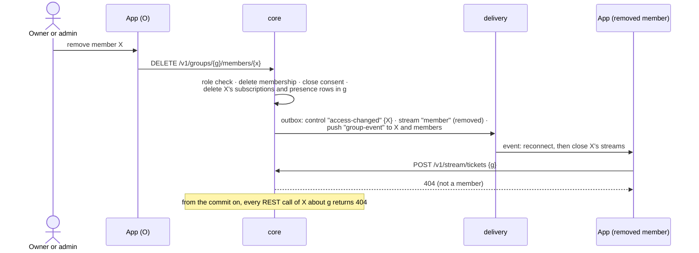

The REST API is safe at commit time because every call checks membership. The stream is safe within seconds through the control event, and in the worst case within the maximum stream lifetime; tickets are valid for 60 s only. Leaving a group is the same flow started by the member; an owner must transfer ownership or delete the group first.

## 12. Silence: watchdog, revival, no-updates alert

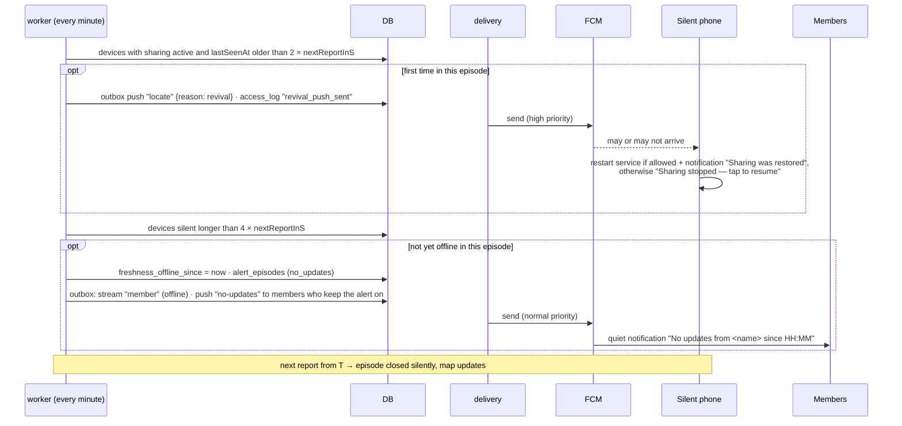

The server does not guess the reason for silence; the status text is neutral. Only one revival push and one alert are sent per episode.

## 13. Account deletion

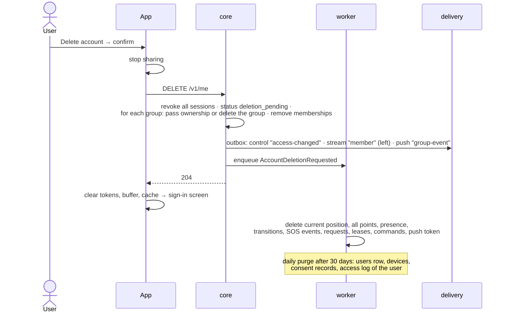

Deletion steps are idempotent and retried until done. Signing in again during the 30-day window creates a fresh account; nothing is restored. The web deletion page (store release) authenticates with Google and calls the same use case.

## 14. Operator action (development and beta builds)

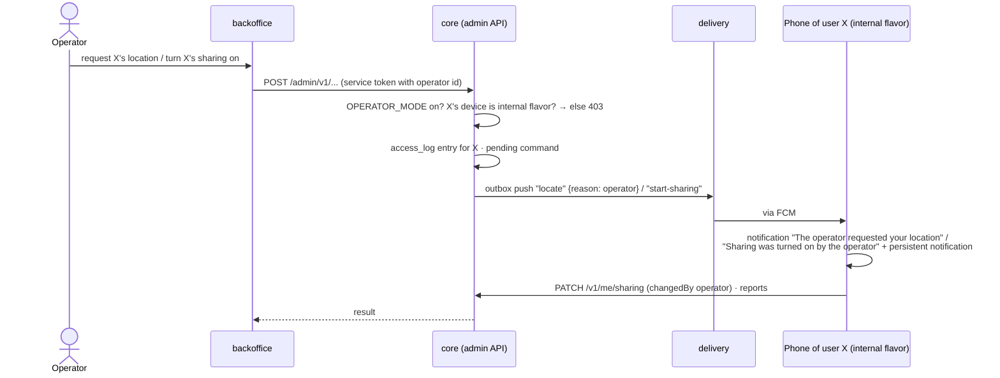

The phone applies the command itself and always shows it. If Android does not allow a background start, the user gets a notification to resume and nothing starts silently (US-093 AC2). In the `store` flavor the handler for `start-sharing` does not exist, and the core refuses the action for such devices.

The operator's passive live overview (the map of all users) sends nothing to phones: the core writes one access-log entry `operator_viewed_live` per person per day while the operator's stream is open (BR-04, US-091 AC2). Until the back office exists, the same operator actions are console commands of the core and follow the same rules.
