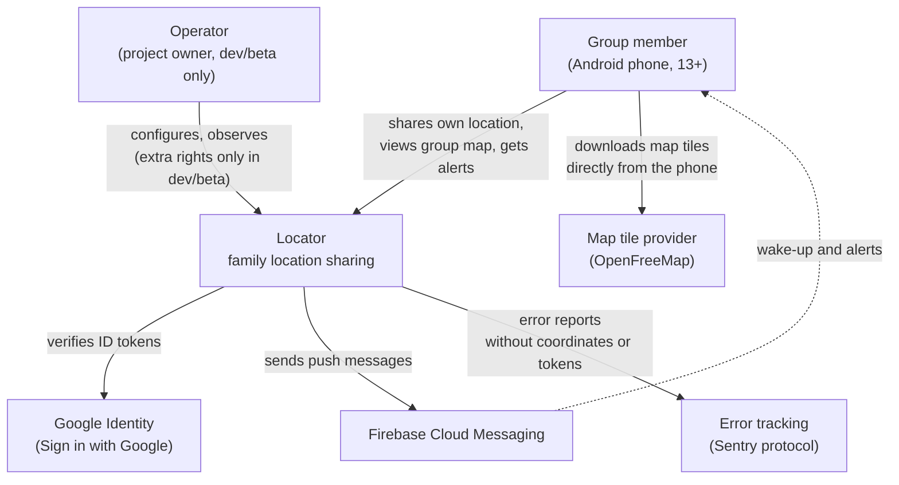
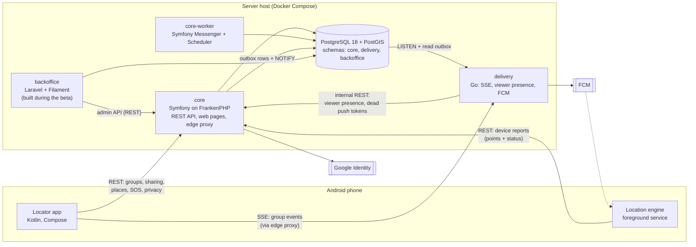

# Architecture overview

> Status: draft for blueprint review · Last updated: 2026-11-15
> Related: [Android](android.md) · [backend](backend.md) · [data model](data-model.md) · [flows](flows.md) · [security](security.md) · [ADR index](adr/README.md) · [API guide](../api/README.md) · [realtime protocol](../api/realtime-protocol.md) · [PRD](../product/prd.md) · [glossary](../product/glossary.md)

## 1. What this document is

A map of the system: who talks to whom, which part owns which rule, and where each decision is recorded. Details live in the linked documents; every significant decision has an ADR. Names of entities follow the **Code term** column of the [product glossary](../product/glossary.md).

Numbers marked *(config)* are server-side configuration; numbers marked *(spike)* are starting values to be confirmed by the location spike on real phones.

## 2. Architecture in seven points

1. **One Android app, three server processes, one database.** The app talks to the `core` over REST and to `delivery` over a one-way event stream. The `backoffice` is the operator's web tool. Everything on the server runs in Docker Compose on a single host.
2. **The `core` is the only source of truth and the only place for business rules.** It is a modular monolith built around the domain (consent, groups, visibility, positions, places, alerts). Every rule from the PRD (BR-01…BR-14) is enforced there. → [ADR-001](adr/ADR-001-core-symfony-modular-monolith.md)
3. **`delivery` is a thin Go service with no business logic.** It keeps long-lived connections to map viewers, knows which groups are being watched, and sends push messages. It delivers only what the core has already decided to deliver. → [ADR-002](adr/ADR-002-delivery-service-in-go.md)
4. **The phone decides when to speak.** The server cannot ask a phone for its location. A single always-on foreground service collects points, adapts its rate, buffers offline and uploads in batches; push messages only speed up mode changes or revive a stopped service. → [ADR-012](adr/ADR-012-always-on-location-foreground-service.md), [ADR-014](adr/ADR-014-push-as-wake-channel.md)
5. **The server owns time and freshness.** Position time is computed by the server from the point's age; freshness is computed from the heartbeat interval the phone itself announced. The app never presents an old position as current. → [ADR-008](adr/ADR-008-server-computed-time-and-freshness.md)
6. **PostgreSQL + PostGIS is the only stateful component.** It stores domain data, the job queue and the event outbox. No Redis, no message broker. → [ADR-004](adr/ADR-004-outbox-and-listen-notify.md), [ADR-007](adr/ADR-007-postgresql-postgis-storage.md)
7. **The API is a contract, written first.** `api/openapi.yaml` is the source of truth for REST; the stream protocol is described in [realtime-protocol.md](../api/realtime-protocol.md). → [ADR-009](adr/ADR-009-contract-first-openapi.md)

## 3. System context (C4 level 1)



External dependencies and what happens when they fail:

| Dependency | Used for | If unavailable |
|---|---|---|
| Google Identity | Sign-in only | Existing sessions keep working; new sign-ins fail with a clear message |
| FCM | Alerts, fresh-location wake-up, service revival | Alerts are delayed or lost; map keeps working; mode changes arrive with the next upload (piggyback channel) |
| Map tiles | Map background | Member list with statuses still works (US-030 AC3); the style URL can be switched from the server without an app release |
| Error tracking | Diagnostics | No effect on users |

## 4. Containers (C4 level 2)



| Container | Technology | Responsibility | State |
|---|---|---|---|
| **Locator app** | Kotlin, Jetpack Compose, Hilt, Ktor Client, Room, DataStore | UI, onboarding and permissions, map, local cache | Cached group data, settings, encrypted session tokens |
| **Location engine** (inside the app) | Foreground service of type `location`, Fused Location Provider, WorkManager watchdog | Collect, filter, buffer and upload points; mode automaton; react to commands | Point buffer, engine state, engine journal |
| **core** | PHP 8.5, Symfony, FrankenPHP (Caddy inside) | All business rules; REST API `/v1`; admin API; public web pages (invitation landing, privacy policy, terms, app-links file); TLS termination and routing to `delivery` and `backoffice` | Stateless |
| **core-worker** | Same code base, Symfony Messenger (PostgreSQL transport) and Scheduler | Asynchronous reactions (place transitions, alerts), scheduled jobs (heartbeat watchdog, retention, pause timers with the end-of-pause push, deletion) | Stateless |
| **delivery** | Go, standard library + PostgreSQL driver + Firebase Admin SDK | SSE streams to viewers; presence of viewers per group; relay of outbox events; FCM sending | In-memory connections; a relay cursor in its own schema |
| **backoffice** | PHP, Laravel + Filament, a TypeScript live-map module | Operator accounts and sign-in, remote configuration editor, read-only views of core data through the admin API, live map for the operator | Own schema `backoffice` |
| **PostgreSQL** | PostgreSQL 18 + PostGIS 3.6 | Domain data, message queue, outbox | The only durable state; nightly encrypted backups |

Memory budget for all five containers is about 1.2 GB *(estimate, to be measured in the walking skeleton)*.

## 5. Ownership rules

These rules decide where new code goes. Violating one requires a new ADR.

| # | Rule | Why |
|---|---|---|
| O1 | **Every table has exactly one owner.** `core` owns schema `core`; `backoffice` owns schema `backoffice`; `delivery` owns schema `delivery` (one cursor table). Database roles enforce it. | Two writers to the same data means two copies of the rules |
| O2 | **Visibility is decided only in the core.** Whether viewer V may see member M's position (BR-01, BR-02, BR-07, BR-11) is computed by one policy in the core. `delivery` filters events only by entitlements the core signed into the stream ticket. | The group boundary must be provable by tests in one place |
| O3 | **`delivery` reads the outbox and nothing else of the core's data.** Push tokens and message payloads arrive inside outbox events. | A compromised or buggy `delivery` cannot query positions |
| O4 | **`backoffice` reaches core data only through the admin API.** Every operator action passes the core, the operator switch and the access log. | BR-04 and BR-11 cannot be bypassed |
| O5 | **The phone is the source of truth for its owner's sharing state.** The server mirrors it; nobody else can change it, except the operator command in development/beta builds, which the phone itself applies and shows. | Consent belongs to the person (BR-03) |
| O6 | **Operator capabilities exist only when both switches are on:** the app's `internal` build flavor and the server's operator mode. The store flavor is compiled without that code. | BR-11, store policy |
| O7 | **No coordinates, place names or tokens** in logs above debug level, error reports, push payloads or analytics of any kind. | BR-13 |

## 6. Core modules (bounded contexts)

The core is one deployable with strictly separated modules. Each has its own domain model, application services, persistence and HTTP layer; modules talk through published interfaces and domain events. Details: [backend.md](backend.md).

| Module | Owns | Key rules |
|---|---|---|
| **Identity** | `User`, `Device`, sessions, sign-in, age/terms confirmation, account deletion | BR-10 one active device; token rotation |
| **Groups** | `Group`, `Membership`, `Role`, `Invitation` | Roles (US-014), limits (BR-12), ownership transfer |
| **Sharing** | `SharingState`, `SharingMode`, `Pause`, `FrequencyProfile`, `Consent`, **visibility policy**, `AccessLogEntry`, `TransparencyView` | BR-01, BR-02, BR-03, BR-04 |
| **Locations** | Device reports, `LocationPoint`, `CurrentPosition`, `DeviceStatus`, `Freshness`, `LocationRequest`, `ActiveView` leases, retention, remote engine configuration | BR-06, BR-08, BR-09, BR-14 |
| **Places** | `Place`, `PlaceSubscription`, `PlaceTransition` detection | Hysteresis (US-042), subscriptions visible to the subject (US-043) |
| **Alerts** | `Sos`, `LowBatteryAlert`, `NoUpdatesAlert`, group event notifications, notification preferences, push composition | BR-07, once-per-episode alerts |
| **Admin** | Admin API for the back office, operator switch, operator actions | BR-11, US-090–US-095 |
| **Platform** (shared kernel) | Outbox, clock, identifiers, error format, authentication middleware, rate limiting | — |

## 7. Main data paths

Sequence diagrams for every path: [flows.md](flows.md).

| Path | Route | Notes |
|---|---|---|
| **Position upload** | Engine → `POST /v1/me/reports` → core → DB (history, current position, device status, outbox) | Idempotent by point id; the response carries commands for the engine (piggyback channel) |
| **Live map** | App → snapshot (REST, core) + stream (SSE, `delivery`) | Stream ticket issued by the core; polling the snapshot every 30 s is the fallback |
| **Fresh location** | Viewer → core → command in the next report response **and** high-priority push → engine switches to active view → upload → stream | Always visible on the target phone; logged in the access log |
| **Alerts** | Core worker → outbox → `delivery` → FCM → phone | Push payloads carry identifiers, not coordinates; the app fetches details over the API |
| **Operator** | Back office → admin API (core) → same paths as above | Only when operator mode is on; every action logged |

## 8. Environments

| Environment | Where | Purpose |
|---|---|---|
| **Local** | Developer PC: Android Studio natively, all server containers in Docker Compose; emulator → `http://10.0.2.2:8080`, phone over USB → `adb reverse tcp:8080 tcp:8080` | Daily development, automated tests |
| **Field test** | Same local stack published through a tunnel with a stable HTTPS address | Location spike and outdoor tests before a server exists |
| **Beta / production** | One ARM virtual machine in the EU, Docker Compose, automatic HTTPS, nightly encrypted backups to two locations | Family beta, later the public release |

Deployment, backups and costs: [deployment](../ops/deployment.md), [costs](../ops/costs.md).

## 9. Repository layout

```
android/                 Android app (standalone Gradle project)
backend/core/            Symfony application (core + core-worker)
backend/delivery/        Go service
backend/backoffice/      Laravel application (built during the beta)
api/openapi.yaml         REST contract (source of truth)
infra/                   Docker Compose files, images, proxy configuration
docs/                    Product, architecture, API, privacy, quality, operations
specs/                   Feature specifications
scripts/                 Developer helper scripts
```

The contract lives in `api/` rather than in `docs/api/` because build tools, linters and tests consume it; `docs/api/` holds the human-readable guides.

## 10. Quality attributes and how the architecture serves them

| Attribute | Architectural answer |
|---|---|
| **Privacy and consent** | Single visibility policy (O2); consent records; access log; no coordinates outside the product (O7); operator rights removable by build and by switch (O6) |
| **Honest freshness** | Server-computed time and freshness; two clocks (position age, last contact); no interpolation |
| **Battery** | Stationary mode without active location requests; adaptive modes; no persistent connection from the sharing phone; stream only while the map is on screen |
| **Reliability of background sharing** | Self-recovery layers in the engine (boot receiver, sticky service, anchor geofence, server watchdog push, WorkManager watchdog); offline buffer with idempotent resend |
| **Simplicity and cost ($0)** | Five containers on one free virtual machine; one database for data, queue and events; no broker, no cache server |
| **Portability and growth** | Stateless services, configuration from environment variables, no cloud-specific services; seams where a broker, a second database or more instances can be added by a new ADR |
| **Evolvability** | Contract-first API; modules with explicit interfaces; `LocationSource` and `WakeChannel` interfaces on the phone for future platforms |

Measurable targets (battery, latency, freshness, availability) are defined in [nfr.md](../quality/nfr.md).

## 11. What is deliberately not built now

| Not now | Seam that keeps it possible |
|---|---|
| Message broker (NATS, Kafka), Redis | Outbox relay and queue transport are interfaces; replacing them is a configuration and ADR matter |
| Kubernetes, multiple hosts | Stateless containers; internal calls already authenticated |
| WebSocket / two-way channel | Needed only for chat; the stream layer is a separate service |
| End-to-end encryption of positions | Conflicts with server-side places and alerts; see [ADR-017](adr/ADR-017-data-protection-without-e2e.md) |
| iOS, Wear OS, web client for users | Client-agnostic contract; no Android-only assumptions on the server |
| Devices without Google Play services | `LocationSource` and `WakeChannel` interfaces |
| Metrics and tracing stack | Structured logs with a request id from day one; OpenTelemetry after the MVP |

## 12. Architecture terms

Terms used across the architecture documents in addition to the [product glossary](../product/glossary.md).

| Term | Meaning |
|---|---|
| **Device report** | One upload from the phone: zero or more points plus the device status. A report without points is a heartbeat. |
| **Piggyback channel** | Commands for the engine returned in the response to a device report. Works without push. |
| **Command** | An instruction from the server to the engine: start an active-view lease, answer a fresh-location request, refresh configuration, re-register the push token. |
| **Lease** | A time-limited permission for a temporary engine mode (active view). Expires by itself if not renewed. |
| **Stream ticket** | A short-lived signed token issued by the core that lets the app open an event stream in `delivery`. Carries the viewer's entitlements. |
| **Entitlement** | What a viewer may receive for a group: member statuses only, or statuses and positions. |
| **Outbox** | A table where the core records events for `delivery` in the same transaction as the data change. |
| **Snapshot** | The full, visibility-filtered state of a group returned by REST; the stream then sends changes. |
| **Admin API** | The core's REST interface for the back office. Not reachable from the internet. |
| **Distribution flavor** | The app's build variant: `internal` (development/beta, may contain operator capabilities) or `store` (Google Play, compiled without them). |
