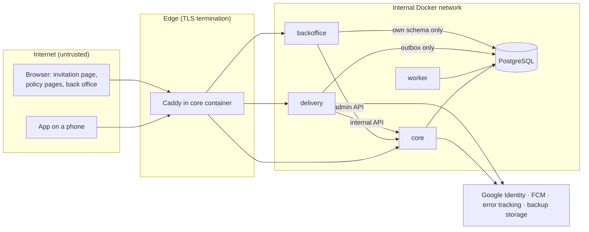

# Security architecture

> Status: draft for blueprint review · Last updated: 2026-11-15
> Related: [overview](overview.md) · [backend](backend.md) · [Android](android.md) · [data model](data-model.md) · [data inventory](../privacy/data-inventory.md) · [ADR-005](adr/ADR-005-stream-tickets.md) · [ADR-015](adr/ADR-015-authentication-and-sessions.md) · [ADR-016](adr/ADR-016-operator-capabilities-flavor-and-switch.md) · [ADR-017](adr/ADR-017-data-protection-without-e2e.md)

## 1. Security goals

In priority order:

1. **Group boundary.** Nobody receives location data of a person they do not share a group with (BR-01).
2. **Consent and reciprocity.** Location is collected only while the person shares; a viewer who does not share sees no positions (BR-02, BR-03).
3. **Nothing hidden.** No server action can start or intensify collection without a visible trace on the person's phone and in their access log (BR-04, BR-05).
4. **Confidentiality of history.** Stored points are the most sensitive data; they must not leak through logs, error reports, backups, pushes or a compromised secondary service.
5. **Account integrity.** A stolen token or phone gives the attacker as little as possible for as short as possible.
6. **Availability** matters, but never at the expense of 1–4.

## 2. Assets, actors and trust boundaries

| Asset | Sensitivity |
|---|---|
| Current positions and history points | Highest |
| Place definitions, place transitions, SOS events | High (reveal home, school, routine) |
| Session tokens, signing keys, FCM service-account key, backup key | High (lead to the above) |
| Account data (name, e-mail, Google identifier, photo URL), group membership | Medium |
| Device status, battery, access log | Medium |
| Remote configuration | Low (integrity matters: wrong parameters drain batteries) |

| Actor | Trust |
|---|---|
| Group member | Authenticated; trusted only for data of groups they are in, and only by the visibility policy |
| Former member, invited stranger | Authenticated; no trust |
| Anonymous internet client | None |
| Controlling partner (the product's anti-persona) | A legitimate member who tries to watch covertly or to coerce |
| Operator | Service administration always; location-related capabilities only in operator mode (BR-11) |
| Hosting, FCM, error-tracking and backup-storage providers | Trusted for availability; given the minimum data |

Trust boundaries: (1) internet → edge; (2) edge → services; (3) each service → database, limited by its role; (4) server → third parties; (5) app → other apps and the user on the phone.

## 3. Authentication

Details and alternatives: [ADR-015](adr/ADR-015-authentication-and-sessions.md).

| Channel | Mechanism |
|---|---|
| App → core | **Access token**: signed JWT, 15 min, claims `sub` (user), `sid` (session), `did` (device), `dist` (distribution). On every request the core also checks that the session is not revoked, so sign-out, device replacement and account deletion take effect immediately |
| Session renewal | **Refresh token**: 256-bit random, stored on the server only as a hash, rotated on every use, 60 days sliding *(config)*. Presenting an already-rotated token revokes the whole session (theft detection) |
| First sign-in | Google ID token from Credential Manager, verified on the server: signature against Google's published keys, issuer, audience = our server client id, expiry, server-issued nonce. The core never sees a Google password or access token |
| App → `delivery` | **Stream ticket**: JWT signed by the core with a separate key, valid 60 s for opening a stream, single use, carries group entitlements. `delivery` holds only the public key ([ADR-005](adr/ADR-005-stream-tickets.md)) |
| `delivery` → core (internal API) | Shared secret in a header, internal network only, endpoints not routed from the edge |
| `backoffice` → core (admin API) | Short-lived service token signed by the back office, carrying the operator id and scope; internal network only |
| Operator → back office | Own accounts with a second factor; separate host name; no self-registration |
| Tests | Test identity provider in a bundle that is absent from production images; a test asserts that |

One active device per account (BR-10): signing in on a new device revokes the previous device's sessions in the same transaction.

## 4. Authorization

**Model:** role-based inside a group (owner, admin, member — US-014) plus the relationship-based **visibility policy** for location data ([backend.md §2.2](backend.md)).

Enforcement rules:

1. Every endpoint that names a group checks current membership first; a non-member gets `404`, never a hint that the group exists.
2. Every read of another person's location data goes through the visibility policy with an explicit viewer context. There is no code path "position by user id".
3. Role checks live in the domain (aggregate methods), not in controllers.
4. The stream applies the same decisions through ticket entitlements; any change of access (removal, leaving, pause, sign-out, deletion) closes the affected streams.
5. Operator endpoints check the operator-mode switch and the target device's distribution on every call.
6. Identifiers are random UUIDs; guessing them gives nothing because of rules 1–2.

**Authorization test matrix** (blocks merging when red): for every endpoint and stream event class × relationship {same group, different group, former member, pending invitee, anonymous} × sharing states {both share, viewer paused, subject paused, subject SOS} → expected result from PRD §2.1. The same matrix runs against `delivery` with crafted tickets (expired, wrong signature, missing entitlement).

## 5. Threat model (STRIDE-lite)

| # | Threat | Category | Mitigation | Residual risk |
|---|---|---|---|---|
| T1 | A user reads positions of a person outside their groups by changing ids in requests | Information disclosure, elevation | Membership check + visibility policy on every path; authorization matrix; `404` for foreign resources | Low |
| T2 | A removed member keeps receiving positions over an open stream | Information disclosure | Control event closes streams within seconds; 60 s tickets; maximum stream lifetime 15 min | Low: seconds of exposure in the normal case |
| T3 | A member watches without sharing (invisible watcher) | Policy bypass | Reciprocity in the policy, in ticket entitlements and in the snapshot; server tests (US-023 AC4) | Low |
| T4 | A controlling member repeatedly forces fresh locations | Abuse | Every request visible on the target phone and in the access log; rate limits (BR-12); target can pause in one tap; paused targets reject requests | Medium: social coercion is outside technical control; transparency is the answer |
| T5 | Someone with physical access to a phone turns sharing on and hides it | Tampering | Persistent notification cannot be hidden by the app; sharing state is on the main screen; Android's own background-location reminder; "Who sees what about me" | Medium: a person who controls another's unlocked phone can do anything |
| T6 | Stolen refresh token used from another device | Spoofing | Rotation with reuse detection; tokens encrypted with a Keystore key and excluded from backups; device binding in the session | Low |
| T7 | Stolen or lost phone | Spoofing | Owner signs in on a new phone → old device revoked (BR-10); account deletion on the web (store release) | Medium until the owner reacts |
| T8 | Forged or replayed Google ID token | Spoofing | Full verification incl. audience and nonce; tokens accepted only when fresh | Low |
| T9 | Invitation code guessing | Elevation | 40-bit single-use codes valid 72 h; rate limits per account and per IP; acceptance requires sign-in and shows the group before joining | Low |
| T10 | Invitation link leaked to a stranger | Elevation | Single use; owner/admins see pending invitations and who joined; every member is notified of a new member; removal in one action | Medium: mitigated by visibility of joins |
| T11 | Fake points uploaded by a modified client (own location spoofing) | Tampering | Accepted as a property of the product: a person controls what they share; `mock` flag from the platform is passed on and shown | Accepted |
| T12 | A member uploads points for another user | Spoofing | Points are bound to the authenticated session's user and device; body ids are ignored | Low |
| T13 | Flooding the upload or request endpoints | Denial of service | Rate limits per device, user and IP; request size limits (200 points, 256 KB); cheap rejection before database work | Medium on a single small host |
| T14 | Exhausting stream connections | Denial of service | Ticket required before any resources are held; per-user connection cap; idle and maximum lifetime | Medium |
| T15 | Compromise of `delivery` | Information disclosure | No access to core tables except the outbox; outbox payloads are already filtered and short-lived; holds no signing keys, only the FCM key | Medium: live events of the compromise period and the push key |
| T16 | Compromise of `backoffice` or an operator account | Information disclosure, elevation | No database rights on `core`; admin API scopes; location capabilities off unless operator mode is on; every action logged and shown to the affected person; second factor | Medium in beta (operator mode on by design), low in the store release |
| T17 | SQL injection, mass assignment, unsafe deserialization | Tampering, disclosure | Parameterized queries only; contract validation with unknown fields rejected; explicit DTO mapping; dependency updates | Low |
| T18 | Coordinates leak through logs, error reports, push or analytics | Information disclosure | Allow-listed log fields; scrubbing filters with tests; pushes carry identifiers only; no analytics SDKs | Low |
| T19 | Backup theft | Information disclosure | Backups encrypted with a public key before leaving the host; private key kept offline by the owner | Low |
| T20 | Host or database compromise | All | Minimal open ports, SSH only through a private network, automatic security updates, secrets outside the repository, least-privilege database roles | High impact; see §7 on encryption limits |
| T21 | Malicious remote configuration (battery drain, tracking intensity) | Tampering | Only the operator publishes; server validates ranges; the app clamps values to built-in bounds; versions kept for rollback | Low |
| T22 | Push spoofing | Spoofing | FCM delivers only messages sent with our service-account key; pushes never carry data to display, only identifiers resolved over the authenticated API; a `locate` push can only ask the phone to do what its owner already allowed | Low |
| T23 | Operator capability reaches the store build | Policy violation | Separate flavor without the code; build check; server refuses operator actions for `store` devices; operator mode off in the store environment | Low |
| T24 | Repudiation: "I did not request that location" | Repudiation | Access log written in the same transaction as the request; visible to the subject for 90 days | Low |
| T25 | Supply chain: a malicious dependency or CI action | Tampering | Lock files, automated update PRs, third-party actions pinned by commit, secret scanning, no advertising or analytics SDKs | Medium |

## 6. Rate limits and input limits

Starting values *(config)*; stored in PostgreSQL, no extra infrastructure.

| Scope | Limit |
|---|---|
| Sign-in attempts | 10 per IP per 10 min |
| Token refresh | 30 per session per hour |
| Device reports | 120 per device per hour sustained, burst 30 per minute; 200 points and 256 KB per request |
| Fresh-location requests | 1 push per target per 30 s; 10 per requester per target per hour (BR-12) |
| Invitation lookups and accept attempts | 10 per account per hour; 30 per IP per hour |
| Invitation creation | 20 per group per day |
| Stream tickets | 30 per user per 10 min |
| Open streams | 3 per user |
| SOS starts | 5 per user per hour |
| Group and place creation | Covered by BR-12 limits |
| Any authenticated endpoint | 600 requests per user per 10 min |

Exceeding a limit returns `429` with `Retry-After`. Limits on SOS never block the first SOS of an episode.

## 7. Data protection and encryption

Decision and alternatives: [ADR-017](adr/ADR-017-data-protection-without-e2e.md) (accepted: option A).

| Layer | Measure |
|---|---|
| In transit | TLS 1.2+ for every public connection (automatic certificates); HSTS; clear text allowed only in debug builds against a local server. Internal calls stay inside one host's Docker network; if services ever move to separate hosts they go over a private encrypted network |
| At rest — server | Encrypted volume for the database; refresh tokens stored as hashes; push tokens and e-mail in plain text inside the database (needed for delivery and recovery) |
| At rest — backups | `pg_dump` encrypted with an asymmetric key on the host; private key offline; two storage locations |
| At rest — phone | Tokens encrypted with a hardware-backed Keystore key; app-private storage for the point buffer; cloud backup disabled |
| Access | Least-privilege database roles; secrets only in the host environment; no production data on developer machines except encrypted backups under test |
| Minimization | Retention limits; immediate deletion of location data on account deletion; no coordinates outside the database |

**What this does not protect against:** someone with full control of the server (the hosting provider, an attacker with root, the operator) can read stored positions, because the server must read them to evaluate places and alerts. End-to-end encryption would remove that ability and those features; it stays a possible future direction (feature F-55). The privacy policy states this openly.

## 8. Secrets

| Secret | Held by | Rotation |
|---|---|---|
| Access-token signing key | core | Key id in the token header; two keys accepted during rotation |
| Stream-ticket signing key (private) / public key | core / `delivery` | Same |
| Internal API secret | core, `delivery` | With deployment |
| Admin API signing key (private) / public key | `backoffice` / core | With deployment |
| Database passwords per role | each service | With deployment |
| FCM service-account key | `delivery` only | In the Firebase console; restricted to messaging |
| Error-tracking DSN | each service, app | Not a secret in the app; scrubbing is the control |
| Backup public key / private key | host / owner, offline | Private key never on the server |
| Android signing keystore | Owner, CI secret | Play App Signing in the store release |
| Google OAuth server client id | core, app | Public value |

Rules: no secret in the repository, in images or in the app; `.env.example` lists names only; a secret scanner runs before commit and in CI; anything that leaks is rotated, not hidden.

## 9. Android-specific measures

- Exported components are limited to the launcher activity, the app-link activity, the boot receiver and the messaging service; everything else is `exported="false"`.
- App links are verified (`assetlinks.json`), so another app cannot claim invitation links.
- `PendingIntent`s are immutable and explicit.
- The store flavor contains no operator code and no debug screens; release builds are minified and not debuggable.
- The app never draws over other apps, never hides its icon, never disguises or removes its persistent notification, and declares no accessibility service — the properties that define stalkerware.
- Mock locations are passed on with a flag, not rejected: a rejected mock would only push people to hide it.

## 10. Audit and detection

| Record | Purpose | Visible to |
|---|---|---|
| Access log | Who requested or viewed a person's location outside normal group viewing | The person; the operator in beta |
| Consent records | When consent was given and withdrawn, and which text was shown | Operator on a lawful request; exported to the person in v1.1 |
| Security events in structured logs: failed sign-ins, token reuse, rate-limit hits, denied admin calls | Detection | Operator |
| Operator session audit | Who used the back office and when | Operator |

Alerts for the operator: token-reuse detection, repeated authorization failures from one account, retention job failed, backup job missed.

## 11. Security acceptance criteria

The MVP is not released to the family beta until all of these hold:

1. The authorization matrix (§4) passes for every endpoint and stream class.
2. A removed member's stream is closed within 5 s in an automated test; the same for a viewer who pauses.
3. Uploading the same batch twice stores each point once; a late point never moves the marker backwards.
4. Scrubbing tests prove that error reports and logs contain no coordinates, place names, tokens or invitation codes.
5. The `store` artifact contains no operator classes; operator endpoints return `403` when operator mode is off.
6. The test identity provider is absent from the production image.
7. Refresh-token reuse revokes the session; sign-in on a second device revokes the first.
8. Account deletion removes all location data of the account within minutes (verified by a test that searches every table).
9. A restore of the latest encrypted backup into a clean environment succeeds.
10. A dependency audit and a secret scan show no known critical issues.
11. A security review of the consent, visibility and operator code has been done by a reviewer other than its author.

## 12. Open questions

| # | Question | Recommendation |
|---|---|---|
| S1 | Encryption beyond transit and volume level (application-level encryption of history) | Decided for the MVP: not used (ADR-017 accepted, option A); reconsider with the history release |
| S2 | Does the operator's passive live overview count as an "operator action concerning a person" that needs a phone notification each time (BR-04)? | **Decided by the owner:** one access-log entry per person per day while the operator views live data, **no phone notification**; explicit actions (request, remote turn-on, history view) always notify. Beta participants are told this before installing |
| S3 | Second sign-in method (e-mail code) as account recovery when the Google account is lost | v2 as planned (F-41); until then a lost Google account means a new Locator account |
