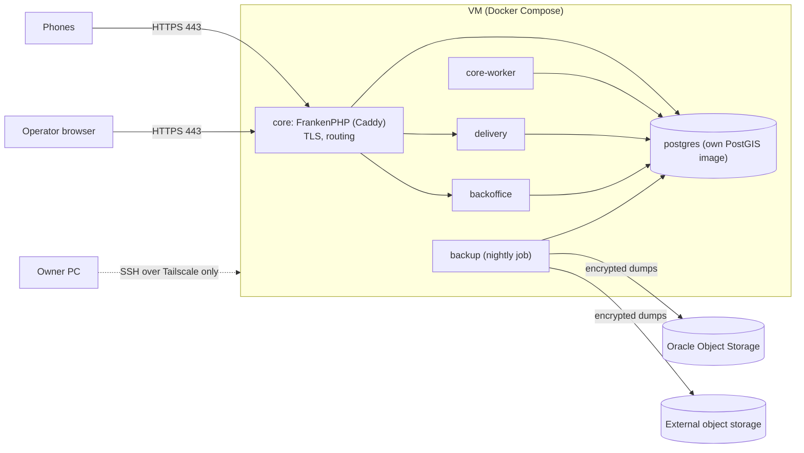

# Deployment and operations

> Status: draft for blueprint review · Last updated: 2026-11-17
> Related: [architecture overview](../architecture/overview.md) · [security](../architecture/security.md) · [CI](ci.md) · [costs](costs.md) · [ADR-019](../architecture/adr/ADR-019-hosting-oracle-always-free.md) · [ADR-020](../architecture/adr/ADR-020-database-image-postgis-multiarch.md) · [ADR-022](../architecture/adr/ADR-022-backups-encrypted-two-locations.md) · [ADR-023](../architecture/adr/ADR-023-error-tracking-sentry-with-scrubbing.md)

## 1. Environments

| Environment | When | Host | Address |
|---|---|---|---|
| Local | Always | Developer PC, Docker Compose | `http://localhost:8080` |
| Field test | Stage 2 until the server exists | Same local stack, Tailscale Funnel | `https://<pc>.<tailnet>.ts.net` |
| Production (beta, then store release) | From stage 8 | One Oracle Cloud Always Free A1 VM, EU region, Ubuntu LTS `arm64` | `https://<name>.dedyn.io` (deSEC); `*.eu.org` later if approved |

There is no separate staging server: the local stack and CI end-to-end tests play that role; production changes are small and reversible.

## 2. Production topology

- Open to the internet: **80** (redirect and certificate challenge) and **443**. SSH listens only on the Tailscale interface.
- The edge proxy inside `core` obtains certificates automatically ([ADR-010](../architecture/adr/ADR-010-frankenphp-runtime-and-edge-proxy.md)); HSTS on.
- Containers run with memory limits, `restart: unless-stopped`, read-only root file systems where possible, and the `json-file` log driver with rotation (10 MB × 5 per container).

## 3. Files

| File | Content |
|---|---|
| `infra/docker-compose.yml` | Services, networks, volumes common to all environments |
| `infra/compose.prod.yml` | Production overrides: image tags from GHCR, memory limits, restart policy, log rotation, no published database port |
| `infra/compose.test.yml` or the `test` profile | `postgres-test` on `tmpfs` and test runners ([ADR-024](../architecture/adr/ADR-024-test-database-compose-profile.md)) |
| `infra/postgres/Dockerfile` | Database image ([ADR-020](../architecture/adr/ADR-020-database-image-postgis-multiarch.md)) |
| `infra/.env.example` | Names of all variables, no values |
| `/opt/locator/.env` (server only) | Real values, mode `600`, owned by the deploy user; never in git |
| `/opt/locator/secrets/` (server only) | FCM service-account key, backup public key |

## 4. One-time server setup *(stage 8)*

1. Create the VM (A1, `arm64`, Ubuntu LTS) in an EU region. Size it for the free-tier idle rules ([ADR-019](../architecture/adr/ADR-019-hosting-oracle-always-free.md)): a family's load keeps CPU and network far below 20%, so the memory used by the stack must stay above 20% of the VM — with a ~1.5 GB stack that means a small shape (for example 1 OCPU / 6 GB) rather than the whole 12 GB allowance. Re-check the idle rules on the Oracle page before creating the VM, and watch the utilization graphs in the first weeks.
2. Create a non-root deploy user; disable password login; install `unattended-upgrades` for security updates.
3. Install Docker Engine and the Compose plugin from Docker's official repository.
4. Install Tailscale; bind SSH to the Tailscale interface; close port 22 in the cloud security list.
5. Open 80/443 in the cloud security list and the host firewall.
6. Point the deSEC name to the VM's public address.
7. Copy `.env` and secrets; run the first deployment (section 5); verify `https://<domain>/health`.
8. Configure the backup job and both storage targets; run a restore drill (section 7).
9. Add the uptime monitor on `/health` and the cron monitor for the backup.

## 5. Deployment procedure

Deployment is started manually by the owner (workflow `deploy.yml`, or the same steps by hand):

1. CI built images for the commit and pushed them to `ghcr.io` with the commit tag ([CI](ci.md)).
2. Connect to the VM over Tailscale.
3. `docker compose pull` with the new tag.
4. Take a pre-migration dump (`backup` container, one-off run).
5. Run database migrations as a one-off container of the new core image. Migrations are backward compatible with the previous release (expand → migrate → contract over two releases).
6. `docker compose up -d` with the new tag.
7. Run read-only smoke checks against the production URL: `/health` of every service and `GET /v1/config`. The test identity provider does not exist in production, so no scripted sign-in is attempted there.
8. If a check fails: redeploy the previous tag; if a migration was not backward compatible, restore the pre-migration dump.

The deployed tag is recorded in a file on the server and in the deployment workflow summary.

## 6. Configuration and secrets

- All configuration comes from environment variables ([backend §8](../architecture/backend.md)); `OPERATOR_MODE` is `on` only during the family beta and `off` from the store release.
- Secrets are listed in [security §8](../architecture/security.md). Rotation: signing keys with a key id (two keys accepted during rotation); database passwords and internal secrets with a deployment.
- A leaked secret is rotated immediately and the leak is recorded; it is never just deleted from history.

## 7. Backups and restore

Per [ADR-022](../architecture/adr/ADR-022-backups-encrypted-two-locations.md):

| Item | Value |
|---|---|
| What | `pg_dump -Fc` of the whole database, nightly and before migrations |
| Encryption | `age` with the owner's public key; private key offline |
| Where | Oracle Object Storage + one external object store |
| Retention | 7 daily + 4 weekly |
| Monitoring | Cron monitor; a missed night alerts the owner |
| Restore test | Monthly: download → decrypt on the owner's PC → restore into the local stack → `scripts/test-backend.ps1` → delete the decrypted copy |
| Disaster drill | Before the beta and yearly: new VM from scratch using this document; measured against NFR-AV-03 (≤ 4 h) |

## 8. Observability

| Signal | Tool | Notes |
|---|---|---|
| Errors and crashes | Sentry Developer ([ADR-023](../architecture/adr/ADR-023-error-tracking-sentry-with-scrubbing.md)) | Scrubbing in every SDK, tested |
| Uptime | Sentry uptime monitor on `/health` | One monitor in the free plan |
| Backup heartbeat | Sentry cron monitor | One monitor in the free plan |
| Logs | Structured JSON to stdout → Docker `json-file` with rotation; `docker compose logs` | No coordinates or tokens above debug level ([backend §10](../architecture/backend.md)) |
| Service statistics | Counts and durations only (reports per hour, open streams, push success rate, share of downgraded high-priority pushes) — console command first, back office later | Never coordinates |
| Metrics and tracing | Not in the MVP; OpenTelemetry later by ADR | — |

Operator alerts ([security §10](../architecture/security.md)): token-reuse detection, repeated authorization failures, failed retention job, missed backup.

## 9. Routine operations

| Task | Frequency |
|---|---|
| Review dependency update pull requests, merge, deploy | Weekly |
| Rebuild the database image for security updates | With dependency updates |
| Restore test | Monthly |
| Check disk usage and table sizes | Monthly |
| Review error tracker and uptime history | Weekly during the beta |
| Raise `targetSdk` when Google Play requires it | Yearly (Google announces the deadline) |

## 10. Incident checklist

1. Is `/health` failing? `docker compose ps`, `docker compose logs --tail 200 <service>`.
2. Database full or slow? Check table sizes, autovacuum and the retention job.
3. Certificates? The edge proxy logs certificate renewal; check that port 80 is reachable.
4. VM lost? Follow the disaster drill (section 7) on a new VM or on plan B ([ADR-019](../architecture/adr/ADR-019-hosting-oracle-always-free.md)).
5. After recovery, tell the beta group what happened and how long data was unavailable.
