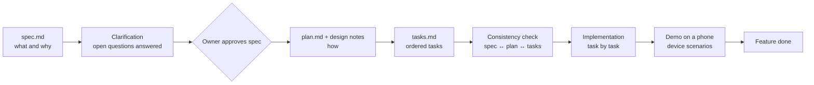

# Development workflow

> Status: draft for blueprint review · Last updated: 2026-11-17
> Related: [specs/README](../../specs/README.md) · [roadmap](../roadmap/roadmap.md) · [testing strategy](../quality/testing-strategy.md) · [device test matrix](../quality/device-test-matrix.md) · [CI](ci.md)

The project is built by one developer, one feature and one task at a time. Everything important lives in files: specifications, plans, task lists, decisions and documentation.

## 1. Feature cycle (spec-driven)

| Step | Output | Who decides |
|---|---|---|
| Specify | `specs/NNN-<feature>/spec.md`: user scenarios, functional requirements, edge cases, success criteria, links to `US-xxx` and `BR-xx`. No technology choices | — |
| Clarify | Up to five targeted questions; answers written into the spec | 👤 Owner answers |
| Approve | Spec status `Approved` | 👤 Owner |
| Plan | `plan.md` (modules, API changes, database changes, tests, risks, check against the project principles), plus `research.md`, `data-model.md`, `contracts/`, `quickstart.md` when needed | — |
| Tasks | `tasks.md`: ordered, each task 30–120 minutes, tests first | — |
| Check | Every requirement has a task and a test; every task traces to a requirement; conflicts with `docs/` are resolved | — |
| Implement | Task cycle (section 2) for each task | — |
| Demo | Stage demo scenario from the [roadmap](../roadmap/roadmap.md) on a real phone; relevant [device scenarios](../quality/device-test-matrix.md) pass | 👤 Owner verifies |

Approved requirements are never changed silently: a wrong spec gets a proposed change that the owner approves.

## 2. Task cycle

1. Read the spec, the plan and the task.
2. Write the failing test that expresses the task's requirement.
3. Implement the smallest change that makes it pass.
4. Run the relevant test scripts; everything green.
5. Mark the task done in `tasks.md`; update `docs/`, ADRs and `api/openapi.yaml` in the same change if behaviour or decisions changed.
6. Commit (section 4).
7. Report: what changed, how it was tested, what the owner should check.

Each task in `tasks.md` states: the requirement it implements, the modules and files it touches, the test to add, the verification command and the done criterion. Tasks that need the owner (a decision, a phone, an account, a payment) are marked 👤.

## 3. Branches

- `main` is always releasable and protected (required CI checks, no force push).
- One short-lived branch per feature: `NNN-short-name`, matching the spec folder.
- Small fixes and documentation: `fix/<topic>`, `docs/<topic>`.
- Pull request into `main`, squash merge after green CI. Tags: `v<semver>` for server releases, `android-v<semver>` for app releases.

## 4. Commits

[Conventional Commits](https://www.conventionalcommits.org/): `feat`, `fix`, `docs`, `test`, `refactor`, `build`, `ci`, `chore`, with a scope where useful (`feat(core): …`, `fix(engine): …`). Messages in English, imperative mood, one logical change per commit.

Before every commit:

- `git status` and `git diff --cached` show only intended files;
- no secrets, no local configuration (`.env`, `local.properties`, keystores);
- all text in the repository is English.

## 5. Definition of Done

**Task:** test written first and passing; all tests of the touched code base green; documentation updated; committed.

**Feature:** all tasks done; acceptance criteria of the linked stories covered by tests; authorization matrix extended for new endpoints or streams; demo scenario verified by the owner; device scenarios passed where background location is involved.

**Roadmap stage:** full test run; review of all changes of the stage (security-sensitive code reviewed by someone other than its author before the beta); manual phone checklist; [roadmap](../roadmap/roadmap.md) and [risks](../roadmap/risks.md) updated; release tag if applicable.

## 6. Reviews

| What | When |
|---|---|
| Self-review of the diff against the spec and the project principles | Every pull request |
| Independent review of consent, visibility, operator and deletion code | Before the family beta and before the store release (security criterion 11) |
| Dependency and secret audit | CI on every change; manual review before releases |

## 7. Decisions

- Technical decisions with alternatives → ADR in [docs/architecture/adr](../architecture/adr/README.md).
- Product decisions → the relevant `docs/product/` document and the spec.
- Every new service, tool or dependency class needs an ADR before it is added.
