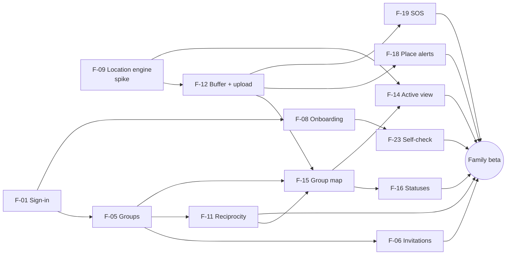

# Feature matrix

> Status: draft for blueprint review · Last updated: 2026-11-17
> Related: [vision](vision.md) · [PRD](prd.md) · [roadmap](../roadmap/roadmap.md)

## 1. Releases

| Release | Who uses it | Distribution | Exit criteria |
|---|---|---|---|
| **MVP — family beta** | Author's family and friends | APK / tester distribution, development/beta build with operator capabilities (disclosed) | All MVP `Must` stories done; device test matrix passed on both test phones (OnePlus 13, RedMagic 8S Pro); battery measured against the ~5%/day target; authorization tests green; security review done; beta participants informed about operator capabilities |
| **v1.1 — history** | Same | Same | History stories done; retention and deletion verified; export works |
| **Play — store release** | Public | Google Play | Operator capabilities absent from the store build; "Only on request" mode; web account deletion; Data safety form, background-location and foreground-service declarations with video; closed test with ≥ 12 testers opted in for 14 consecutive days ([Play Console help](https://support.google.com/googleplay/android-developer/answer/14151465)) |
| **v2** | Public | Google Play | Per feature |
| **Later** | — | — | Ideas the architecture must not block; each needs its own decision |

The order MVP → v1.1 → Play follows the project plan; v1.1 and Play are independent and may swap if publication becomes more important than history.

## 2. Legend

- **Complexity:** `S` — a few days of focused work, one module · `M` — one feature spec, several modules · `L` — several specs or a new technical area · `XL` — the main technical risk of the project, needs a spike.
- **Risk:** `L` — known territory · `M` — some unknowns, recoverable · `H` — platform/policy behaviour can break the feature or block publication.
- **Depends on:** features that must exist first.

## 3. Matrix

### MVP — family beta

| ID | Feature | Priority | Complexity | Risk | Depends on | Stories |
|---|---|---|---|---|---|---|
| F-01 | Google sign-in, secure session, age/terms confirmation | Must | M | L | — | US-001, US-002, US-003, US-007 |
| F-02 | One active device per account, move to a new phone | Must | S | L | F-01 | US-004 |
| F-03 | Account deletion in the app | Must | M | M — deletion must be complete and ordered | F-01, F-05 | US-005 |
| F-05 | Groups, roles, several groups, ownership transfer, group deletion | Must | M | L | F-01 | US-010, US-013, US-014, US-017 |
| F-06 | Invitations: code, link (app links on our domain), web fallback page | Must | M | M — free domain and link verification | F-05 | US-011, US-012 |
| F-07 | Leave group, remove member (closing open streams) | Must | S | M — revocation must reach the realtime service | F-05, F-15 | US-015, US-016 |
| F-08 | Onboarding: prominent disclosure, two-step permissions, battery, unused-app restrictions and phone-maker instructions | Must | L | **H** — store policy; phone-maker differences | F-01 | US-020 |
| F-09 | Location engine: foreground service, modes, adaptive frequency, profiles, restart after reboot | Must | **XL** | **H** — background limits, phone-maker killers, battery | — (spike first) | US-021, US-024, US-025 |
| F-10 | Visible pause with timer | Must | M | M — automatic resume from background (end-of-pause push) | F-09, F-21 | US-022 |
| F-11 | Reciprocity rule in every endpoint and stream | Must | M | M — must be proven by tests | F-05 | US-023 |
| F-12 | Offline buffer, idempotent batch upload, server time | Must | M | M | F-09 | US-026 |
| F-13 | Device status reporting: limited modes, location off, no permission, power saving | Must | M | M | F-09 | US-027 |
| F-14 | Active view and fresh-location request (push wake-up) | Must | L | **H** — push delivery and background start limits | F-09, F-15, F-22 | US-028 |
| F-15 | Group map with realtime updates (stream + polling fallback) | Must | L | M — new service, map library in Compose | F-05, F-12 | US-030, US-035 |
| F-16 | Freshness statuses, accuracy, battery, member card | Must | M | M — thresholds tuned after spike | F-13, F-15 | US-031, US-032, US-033, US-034 |
| F-17 | Places: create/edit/delete, subscriptions, "who gets alerts about me" | Must | M | L | F-05, F-15 | US-040, US-041, US-043 |
| F-18 | Server-side place transitions and arrival/departure alerts | Must | L | M — hysteresis, accuracy, delay | F-12, F-17, F-21 | US-042 |
| F-19 | SOS: send, end, receive; works while paused | Must | L | M — must be reliable under poor connectivity | F-09, F-12, F-21 | US-050, US-051, US-052 |
| F-20 | Low-battery and "no updates" alerts (heartbeat watchdog) | Must | M | M — false alarms at night | F-13, F-21 | US-060, US-061 |
| F-21 | Push notifications infrastructure, group events, preferences | Must | M | L | F-01 | US-062, US-063 |
| F-22 | "Who sees what about me" and access log | Must | M | L | F-05, F-17 | US-070, US-071 |
| F-23 | Reliability self-check | Must | L | M — phone-maker settings are not detectable everywhere | F-08, F-13 | US-072 |
| F-24 | Privacy policy and terms pages, links in app | Must | S | L | domain | US-073 |
| F-28a | Retention cleanup of stored points (30 days default) | Must | S | L | F-12 | BR-14 |
| F-30 | Operator disclosure and build/server switches | Must | M | **H** — must be cleanly removable before Play | F-01 | US-090, US-094 |
| F-31 | Back office: operator overview, fresh-location request, remote turn-on (console commands of the core until the back office exists; built during the beta, not required to start it) | Should (remote turn-on — Could) | L | M | F-14, F-30 | US-091, US-092, US-093 |
| F-32 | Remote configuration of engine parameters and map style | Should | M | L | F-09 | US-095 |
| F-35 | Localization: Ukrainian + English | Must | M | L | — | US-110 |
| F-36 | Accessibility basics | Must | M | L | — | US-111 |
| F-37 | Unsupported device check | Must | S | L | — | US-112 |

### v1.1 — history

| ID | Feature | Priority | Complexity | Risk | Depends on | Stories |
|---|---|---|---|---|---|---|
| F-25 | Data export (JSON, tracks as GPX) | Should | M | L | F-26 | US-074 |
| F-26 | My history: day view, stop detection, noise filtering | Must | L | M — filtering quality | F-12, F-28a | US-080 |
| F-27 | Share history with a group or a person; shown on transparency screen | Must | M | M — new visibility level | F-22, F-26 | US-081 |
| F-28b | Retention setting and history deletion | Must | S | L | F-26 | US-082, US-083 |
| F-29 | Per-group sharing switch and pause | Should | M | M — reciprocity per group | F-11 | US-084 |

### Play — store release

| ID | Feature | Priority | Complexity | Risk | Depends on | Stories |
|---|---|---|---|---|---|---|
| F-04 | Web account deletion | Must | S | L | F-03, F-24 | US-006 |
| F-33 | "Only on request" sharing mode | Must | L | **H** — push wake-up reliability | F-14 | US-100 |
| F-34 | Store compliance package: store build without operator code, Data safety, background-location and foreground-service declarations, review video, closed testing | Must | M | **H** — review outcome | F-30, F-33 | — |

### v2

| ID | Feature | Priority | Complexity | Risk | Depends on | Stories |
|---|---|---|---|---|---|---|
| F-40 | Approximate area per group | Should | M | M | F-29 | US-130 |
| F-41 | Email + one-time code sign-in | Should | M | M — free email sending limits | F-01 | US-131 |
| F-42 | Trip detection | Could | L | M | F-26 | US-132 |
| F-43 | Home-screen widget | Could | S | L | F-16 | US-133 |
| F-44 | Show the user the app's own battery use | Could | M | M — Android does not expose it directly | F-09 | — |

### Later

| ID | Idea | What must not be blocked now |
|---|---|---|
| F-50 | Web panel for users | API is contract-first and client-agnostic |
| F-51 | iOS client | Same API; no Android-only assumptions on the server |
| F-52 | Wear OS | Location source and wake channel behind interfaces |
| F-53 | Chat in groups | Realtime layer can be extended; needs its own decision (two-way channel) |
| F-54 | Devices without Google Play services | Location source and wake channel behind interfaces |
| F-55 | End-to-end encryption of positions | Conflicts with server-side places and alerts — needs research and a decision |
| F-56 | Quiet hours for non-SOS alerts | Notification preferences are per user and per group |

**Not planned:** child accounts, parental-control features, monetization, ads.

## 4. Why the split looks like this

1. **The MVP is what makes the family use the app daily.** The owner explicitly put places with alerts, SOS and low-battery/"no updates" alerts into the first version. They are affordable because **places are evaluated on the server** from received points: no on-device geofencing limits, and the same data path as the map.
2. **Reliability and trust features are in the MVP, not later.** The most common complaint in the category is "it does not update", and the main fear is surveillance. The self-check (F-23), honest statuses (F-16), reciprocity (F-11) and the transparency screen (F-22) address both, and they cost far less than losing the family's trust in the first weeks.
3. **The location engine (F-09) is the only XL item and is built first, as a spike** on real phones, before accounts and groups. If background sharing does not work reliably on the test phones, everything else is pointless.
4. **History is v1.1** because it is the most sensitive data and needs its own visibility level; points are nevertheless **stored from day one** with retention cleanup (F-28a), so v1.1 has data to show.
5. **The Play release is a separate step** because store policy changes the product: operator capabilities must be removed, "Only on request" replaces remote turn-on, and the closed test needs 12 testers for 14 days.
6. **v2 and Later** contain features that broaden the audience (email sign-in, approximate sharing, other platforms). The architecture keeps the required seams (contract-first API, location source and wake channel interfaces), but no work is spent on them now.

## 5. Critical path (MVP)

The detailed order, demos and Definition of Done per stage are in the [roadmap](../roadmap/roadmap.md).
