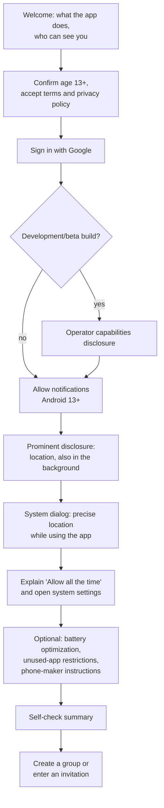

# User journeys

> Status: draft for blueprint review · Last updated: 2026-11-15
> Related: [personas](personas.md) · [PRD](prd.md) · [glossary](glossary.md)

Each journey describes one scenario end to end: who, what triggers it, the steps, **what other group members see**, and what can go wrong. Screen names are functional placeholders; layouts are produced in the design stage. Sequence diagrams of the system side are in `docs/architecture/flows.md` (architecture stage).

| ID | Journey | Release | Personas |
|---|---|---|---|
| J-01 | First install and onboarding | MVP | all |
| J-02 | Create a group and invite family | MVP | Olena |
| J-03 | Join a group by invitation | MVP | Halyna, Maks |
| J-04 | Daily glance at the map | MVP | Olena |
| J-05 | Get a fresh location | MVP | Olena |
| J-06 | Pause and resume sharing | MVP | Maks |
| J-07 | Places and arrival/departure alerts | MVP | Olena, Maks |
| J-08 | SOS | MVP | Halyna |
| J-09 | Someone went silent | MVP | Olena, Halyna |
| J-10 | Fix my own reliability | MVP | Maks, Halyna |
| J-11 | Who sees what about me | MVP | Maks |
| J-12 | Leave, remove, delete | MVP | all |
| J-13 | New phone | MVP | Olena |
| J-14 | Operator debugging (development/beta build) | MVP | Andrii |
| J-15 | Look at my history and share it | v1.1 | Ira, Olena |
| J-16 | Share only on request | Play | Maks |

---

## J-01. First install and onboarding (MVP)

**Actor:** any new user. **Trigger:** installs the app (beta: from a link; later: Google Play), often guided by a relative.

**Steps and rules**
1. The welcome screen states in plain language: your location is shared only with groups you join, only while sharing is on, and everyone sees when you pause.
2. Age confirmation (13+) and acceptance of terms and the privacy policy are explicit actions (US-007).
3. Sign-in uses the system Google account picker (US-001).
4. Development/beta build only: a screen lists operator capabilities; the user must confirm to continue (US-090).
5. The prominent disclosure appears **before** any system location dialog, contains the words "location" and "in the background / when the app is closed", and requires a button press (US-020).
6. Background permission ("Allow all the time") is requested as a separate second step through system settings, after an explanation screen.
7. Battery optimization, the system's unused-app restrictions and phone-maker instructions are recommended, not required; the user can skip. The screen explains why this matters most for people who rarely open the app: after months without opening it, Android may remove the location permission.
8. The self-check summary shows what is configured and what is not (US-072).
9. Sharing starts only when the user turns it on, at the earliest after joining or creating a group.

**What others see:** nothing until the user joins a group and turns sharing on.

**What can go wrong**
| Situation | Behaviour |
|---|---|
| User denies location | The user can join groups but cannot share, so by the reciprocity rule sees only names and statuses; the group sees "no permission"; the self-check explains how to fix it |
| User grants only "while using the app" | Limited mode: points only while the app is open; group sees "limited: only while app is open" (US-027) |
| User grants approximate location only | Sharing works with an "approximate" badge and a large accuracy circle; self-check recommends precise |
| No Google Play services or Android < 10 | Clear "this device is not supported" screen (US-112) |
| User leaves onboarding halfway | Next launch resumes at the first unfinished step |

---

## J-02. Create a group and invite family (MVP)

**Actor:** Olena. **Trigger:** first launch after onboarding, or "New group" from the group list.

1. Olena enters a group name ("Family"). She becomes the **owner** (US-010).
2. She taps "Invite", gets a single-use invitation with a short code and a link, and shares it through any messenger (US-011).
3. Pending invitations are listed with their expiry; she can revoke one.
4. When someone joins, all members get a "Halyna joined Family" notification (US-062).

**What others see:** existing members see the new member in the list immediately; their position appears once they share.

**What can go wrong:** invitation expired or already used → the invitee sees a clear message and asks for a new one; group is full (20 members) → invitation cannot be created.

---

## J-03. Join a group by invitation (MVP)

**Actor:** Halyna (with Olena on the phone), Maks. **Trigger:** taps the link or enters the code.

1. If the app is not installed, the link opens a web page with install instructions; after install, the user enters the code.
2. The invitation screen shows: group name, who invited, the current members, and **what joining means**: "Members of Family will see your location while your sharing is on. You will see theirs while you share." (US-012).
3. Accept → membership is created; if sharing is off, the app offers to turn it on. Decline → nothing is stored except the declined invitation.

**What others see:** "Halyna joined"; then her status ("no location yet" → live position).

**What can go wrong:** user already in the group → open the group; user is in the maximum number of groups → explain the limit.

---

## J-04. Daily glance at the map (MVP)

**Actor:** Olena. **Trigger:** opens the app.

1. The map of the last used group opens, with a marker for each member (US-030).
2. Each marker shows freshness: **Live** (≤ 2 min), **Recent**, **Stale**, **Offline**, or a status badge — **Paused**, **Location off**, **No permission**, **Power saving / low battery** (US-031).
3. Tapping a member opens the member card: position age ("at this place since 08:10, checked 3 min ago"), last contact, accuracy, battery, status reason (US-034).
4. Switching groups is one tap (US-035).

**Reciprocity:** if Olena's own sharing is paused, she sees names and statuses but no positions, and a banner "Resume sharing to see others" (US-023).

**What others see:** while Olena keeps the map open, members' persistent notifications show "Olena is viewing the map" and their phones report more frequently for a limited time (US-028).

---

## J-05. Get a fresh location (MVP)

**Actor:** Olena. **Trigger:** taps "Refresh" on Maks's card because his position is 12 minutes old.

1. The app immediately shows the current known position with its age and "Requesting a fresh location…".
2. Maks's phone receives the request, briefly switches to frequent updates and sends a fresh point; the card updates (US-028).
3. If no fresh point arrives within 60 s: "Could not get a fresh location. Last known: 12 min ago" — never a fake update.

**What Maks sees:** a visible notification "Olena requested your location", and an entry in his access log (US-071).

**Limits:** requests to the same person are rate-limited; requests are impossible when the target is paused (the card says "Paused since 14:05").

---

## J-06. Pause and resume sharing (MVP)

**Actor:** Maks. **Trigger:** wants privacy for the evening.

1. Taps "Pause" on the main screen or in the persistent notification; chooses "1 hour", "until tomorrow 08:00" or "until I resume" (US-022).
2. Location collection stops immediately; the sharing service stops, and its persistent notification is replaced by a quiet notification "Paused until 21:00 · Resume".
3. When the timer ends, sharing resumes through the server's end-of-pause wake message or the phone's own alarm (or he is asked to resume if Android does not allow an automatic restart).

**What others see:** "Paused until 21:00" with the last position before the pause dimmed. No "phone died" ambiguity.

**Reciprocity:** while paused, Maks sees names and statuses but not positions. SOS from anyone is still shown with location.

---

## J-07. Places and arrival/departure alerts (MVP)

**Actors:** Olena (admin), Maks (member). **Trigger:** Olena wants to know when Maks gets home.

1. Olena creates a place "Home": point on the map + radius (100–1000 m) (US-040). Owners and admins can create, edit and delete places.
2. She opens "Home" and subscribes to "arrivals and departures" (US-041). Any member can subscribe to any place of the group.
3. All members are informed: "Olena will get alerts when you arrive at or leave Home" (US-043); the subscription appears on their transparency screens.
4. When Maks's points cross the boundary, the server detects the transition and Olena gets "Maks arrived at Home · 15:42" (US-042).

**Rules:** alerts are computed on the server from received points, so they arrive with the delay of the sharing frequency (typically 1–15 min) — the alert shows the actual crossing time. No alerts about a paused person. A subscriber who has paused sharing does not get alerts (reciprocity).

---

## J-08. SOS (MVP)

**Actor:** Halyna. **Trigger:** feels unwell in the street.

1. She presses and holds the SOS button (accidental taps do nothing) (US-050).
2. Her phone immediately sends the last known position, then switches to very frequent updates for 15 minutes — **even if her sharing was paused**; the app tells her that.
3. The SOS screen offers "Call 112" (opens the dialer) and "Cancel SOS".
4. All members of all her groups get a high-importance notification "Halyna sent SOS" with the position and its age; tapping opens the live map (US-052) — including members who are paused.
5. She or the timeout ends the SOS; members get "Halyna: SOS ended" (US-051).

**What can go wrong:** no network → SOS is queued and sent automatically when the network returns; Halyna sees "not delivered yet"; no GPS fix → last known position with its age.

---

## J-09. Someone went silent (MVP)

**Actor:** Olena. **Trigger:** Halyna's phone stops reporting.

1. The server expects Halyna's next heartbeat; when it is late, her marker turns **Stale**, then **Offline** ("not in contact since 09:12") (US-031).
2. On the transition to Offline, members who keep the alert enabled get one quiet notification "No updates from Halyna since 09:12" (US-061). Neutral wording: we do not guess the reason.
3. Low battery: when Halyna's phone reports < 15% and not charging, members get "Halyna's battery is low (12%)" once per discharge (US-060).

**On Halyna's side:** if the app is alive but restricted, her self-check shows what to fix (J-10).

---

## J-10. Fix my own reliability (MVP)

**Actor:** Maks. **Trigger:** his mother says "you were offline all day".

1. Opens "Reliability check" (US-072): each item is green/amber/red — location permission (all the time / precise), notifications, battery optimization, phone-maker autostart/background restrictions, power saving, location services on, last successful upload.
2. Each red/amber item has a "Fix" button that opens the exact system screen, plus short phone-maker-specific instructions where known.
3. The check also runs automatically after onboarding and when the app detects a problem (for example, a revoked permission), with a notification.

---

## J-11. Who sees what about me (MVP)

**Actor:** Maks. **Trigger:** curiosity or doubt.

One screen (US-070) answers:
- the groups where I share, my current sharing state and frequency profile;
- who in each group can currently see my position (members who share);
- who gets arrival/departure alerts about me, for which places;
- recent fresh-location requests: who and when (US-071);
- operator actions (development/beta build): what and when;
- (v1.1) who can see my history.

---

## J-12. Leave, remove, delete (MVP)

| Action | Who | Result | Others see |
|---|---|---|---|
| Leave a group (US-015) | any member; an owner must first transfer ownership or delete the group | Membership ends immediately; no more sharing with that group | "Maks left Family" |
| Remove a member (US-016) | owner; admins can remove members but not other admins or the owner | Removed person loses access immediately and is notified | "Maks was removed" |
| Delete account (US-005) | the user, in the app (and on the web in the Play release) | Sharing stops, the account is deactivated immediately, data is deleted (see PRD) | The member disappears from all groups |

---

## J-13. New phone (MVP)

**Actor:** Olena. **Trigger:** replaces her phone.

1. Installs the app, signs in with the same Google account, completes permissions (J-01 without the group step).
2. The new phone becomes her sharing device; the old phone, if still signed in, stops sharing and shows "Sharing moved to another device" (US-004).

---

## J-14. Operator debugging (MVP, development/beta build only)

**Actor:** Andrii. **Trigger:** Halyna has been Offline since the morning.

1. In the back office (until it exists — console commands of the core), Andrii opens Halyna's device status: last contact, reported permissions, power saving, unused-app restrictions, app version, engine mode history (US-091).
2. He requests a fresh location (US-092). If her sharing is off, he can turn it on remotely (US-093); Android shows the persistent notification on her phone as usual.
3. Each explicit action appears in Halyna's access log with Andrii's name and shows a notification on her phone. Simply watching the live map of all users is recorded in her access log once a day, without a notification (BR-04).
4. If the issue is a parameter (for example, too long a stationary interval), he changes the engine configuration remotely (US-095).

---

## J-15. Look at my history and share it (v1.1)

**Actor:** Ira. **Trigger:** wants to recall yesterday's route; Olena wants to see where her mother walked.

1. Ira opens "My history", picks a day, sees the track with stops (noise filtered) (US-080).
2. History is visible only to her by default. She can share it with a group or with one person (US-081), and can delete a day or all history (US-083).
3. Retention: 30 days by default, configurable (US-082).

---

## J-16. Share only on request (Play release)

**Actor:** Maks. **Trigger:** wants his friends to be able to locate him, but not continuously.

1. Switches his sharing mode to "Only on request" (US-100).
2. His phone sends no periodic positions; members see "On request" instead of a position age.
3. When a member requests his location, his phone shows a notification "Ira requested your location", sends one fresh point and returns to the economical state.
