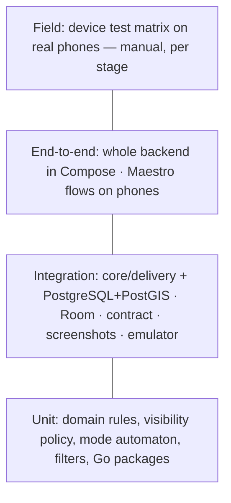

# Testing strategy

> Status: draft for blueprint review · Last updated: 2026-11-17
> Related: [NFR](nfr.md) · [device test matrix](device-test-matrix.md) · [backend §11](../architecture/backend.md) · [Android §11](../architecture/android.md) · [security §11](../architecture/security.md) · [CI](../ops/ci.md) · [ADR-024](../architecture/adr/ADR-024-test-database-compose-profile.md) · [ADR-025](../architecture/adr/ADR-025-developer-commands-powershell-scripts.md)

## 1. Principles

1. **Test first.** Every task starts with a failing test that expresses the requirement (a story's acceptance criterion or a business rule `BR-xx`).
2. **The riskiest rules get the fastest tests.** Visibility, reciprocity, consent, freshness and the location engine's mode automaton are pure logic and are covered by unit tests that run in seconds.
3. **Real database, no mocks of SQL.** Anything that depends on PostgreSQL or PostGIS behaviour is tested against the real database image.
4. **The authorization matrix is a product feature.** It is a dedicated suite; a red matrix blocks merging.
5. **Real phones decide.** Background location is accepted only by the [device test matrix](device-test-matrix.md).
6. **One command per level, same command in CI** ([ADR-025](../architecture/adr/ADR-025-developer-commands-powershell-scripts.md)).

## 2. The pyramid

| Level | Share of tests | Runs |
|---|---|---|
| Unit | Most | Every pull request (path-filtered) |
| Integration, contract, screenshots | Many | Every pull request for the changed code base |
| Emulator (instrumented) | Few | Manually, by pull-request label, nightly when Android changed |
| End-to-end backend | A dozen scenarios | Pull requests touching the backend or `api/` |
| Maestro on phones | A handful of flows | Before a stage demo and before releases |
| Device test matrix | Per stage | Spike, stage demos, beta, store release |

## 3. Backend

| Level | What | Tools | Command |
|---|---|---|---|
| Unit (no framework) | Visibility policy and reciprocity, consent and pause rules, freshness statuses from promised heartbeat, place hysteresis, role rules, retention calculations, rate-limit arithmetic | PHPUnit; `go test` | `scripts/test-backend.ps1 -Unit` |
| Integration | Doctrine repositories; upsert "only if newer"; idempotent point inserts; batched retention deletes; `ST_DWithin`; Messenger PostgreSQL transport; outbox → `NOTIFY` → `delivery`; stream ticket verification | PHPUnit and Go tests against `postgres-test` in the Compose `test` profile ([ADR-024](../architecture/adr/ADR-024-test-database-compose-profile.md)); isolation by transaction rollback (PHP) or schema per package (Go) | `scripts/test-backend.ps1` |
| Authorization matrix | For **every** endpoint and stream class: non-member, member not sharing (reciprocity), paused member, removed member, other group's admin, operator with `OPERATOR_MODE` on/off, `store` device. Expected `404`/`403`/close within 5 s | HTTP tests in the core; stream tests in `delivery`; the matrix is a data table, each row a test | Part of `scripts/test-backend.ps1`; separate CI job, required |
| Contract | `api/openapi.yaml` lint; no breaking changes against `main`; core responses validated against the schema in HTTP tests | Redocly CLI (lint), oasdiff (breaking changes), Gesso `studio-design/gesso` in PHPUnit (see below) | `scripts/test-contract.ps1` |
| Scrubbing | Error reports and logs contain no coordinates, place names, tokens, e-mail addresses, invitation codes | Unit tests of each `beforeSend` filter and log processor | In unit suites |
| End-to-end | `docker compose up --wait`, then: test sign-in → create group → invite → accept → device reports → group snapshot → stream event → pause hides position → remove member closes stream → delete account removes data | Scenarios in Go (one language less than adding a Node test runner) against the public API only | `scripts/e2e-backend.ps1` |
| Load (before beta) | 100 simulated devices on typical-day intervals; check NFR-SRV-01…06 | Small Go program in `scripts/` or k6 in a container (chosen in stage 8) | Manual |

**Contract validator (stage 1).** Chosen: Gesso 2.10 (MIT; OpenAPI 3.0/3.1/3.2; Symfony adapter; PHPUnit 12/13). Evaluated first per the walking-skeleton research; it loads the whole `api/openapi.yaml` (3.1 constructs included), accepts the `Health` and `RemoteConfig` responses and rejects a wrong `/health` body (`{"status":"fine"}`), a body without `status` and a `RemoteConfig` without required fields. The test helper is `backend/core/tests/Support/AssertsOpenApiResponse.php`; the two fallbacks (`league/openapi-psr7-validator`, plain JSON Schema 2020-12) were not needed.

**Breaking-change check (stage 1).** oasdiff 1.39.0 from the regular `tufin/oasdiff` image (no separate OpenAPI 3.1 tag was needed) parses the whole contract; with a copy that drops `version` from `RemoteConfig` it fails with `response-required-property-removed` as `ERR`, and it reports no breaking change for making `GET /v1/config` public (no waiver). Lint: Redocly CLI 2.82.0. Both images are pinned by digest in `scripts/test-contract.ps1`. Go test reports in JUnit format come from gotestsum ([ADR-026](../architecture/adr/ADR-026-go-test-reports-gotestsum.md)).

**Test identity.** Google ID tokens cannot be produced in tests. A test identity provider issues sessions for scripted users. It is a separate bundle that is not installed in production images; a test asserts its routes return `404` in the production image (security criterion 6).

**Time.** `Clock` is injected everywhere; no test sleeps to wait for time to pass.

## 4. Android

| Level | What | Tools | Command |
|---|---|---|---|
| Unit (JVM) | `ModeController` transitions and priorities with a fake clock and scripted location streams; `PointFilter`; `Uploader` batching and back-off; buffer limits; age-based time model; DTO mapping and problem-details errors; view models (`UiState` for each event) | JUnit, kotlinx-coroutines-test, Turbine; fakes from `core:testing` (clock, location source, API server, dispatchers) | `scripts/test-android.ps1` |
| UI on JVM | Screens in both languages, dark theme, 200% font; status chips and freshness texts | Compose UI tests on Robolectric; screenshot tests with Roborazzi | `scripts/test-android.ps1` |
| Instrumented (emulator) | Room migrations; foreground-service start rules; permission flows on API 29, 30 and latest; WorkManager watchdog; boot receiver | AndroidX Test on an emulator: Gradle Managed Devices locally, emulator runner in CI | `gradlew :app:connectedInternalDebugAndroidTest` (wrapped later) |
| Build checks | `store` artifact contains no `feature:operator` classes; no network clear-text in release; lint (including hard-coded strings) | Gradle task inspecting the APK; Android Lint | In `scripts/test-android.ps1` |
| End-to-end on phones | Onboarding with system permission dialogs; invitation; map shows the second phone; pause; SOS | Maestro flows over `adb` on P1/P2; `setLocation`/`travel` on API 31+ emulators | `maestro test android/maestro/` (wrapped later) |

**How to test location and background behaviour without a phone:**

- **Mode automaton:** scripted streams of fixes (stationary jitter, walking at 1.4 m/s, driving at 15 m/s, GPS loss) fed into `ModeController` with a fake clock; assertions on emitted location requests and modes.
- **Buffer and upload:** fake API server returning success, `429`, `5xx`, partial acceptance; assertions on ordering and deletion.
- **Emulator:** `adb emu geo fix <lon> <lat>` and GPX playback in the emulator's extended controls; Maestro `travel` for routes.
- **Doze on emulator (smoke only):** `adb shell dumpsys deviceidle force-idle` and `adb shell dumpsys battery unplug`; real Doze behaviour is still verified only on phones.

## 5. What blocks a merge

| Check | Blocking |
|---|---|
| Unit and integration suites of changed code bases | Yes |
| Authorization matrix | Yes, always runs when the core or `delivery` changed |
| Contract lint and breaking-change check | Yes, when `api/` changed |
| Scrubbing tests | Yes |
| Android unit, screenshot, lint, store-build check | Yes, when `android/` changed |
| End-to-end backend | Yes, when the backend or `api/` changed |
| Secret scan | Yes |
| Emulator tests | No (nightly/label); a failure must be fixed before the stage demo |
| Device test matrix | Not a CI check; required for the stage Definition of Done |

## 6. Test data

- Fixed scripted users and groups created through the public API in end-to-end tests; no SQL fixtures for end-to-end.
- Coordinates in tests are synthetic points around a neutral location; real family locations never appear in tests, logs or screenshots.
- Production data is never copied to developer machines except encrypted backups during the monthly restore test, which are deleted afterwards.

## 7. Traceability

- Each story `US-xxx` acceptance criterion maps to at least one test; the test name contains the story id (for example `US023_nonSharingMember_doesNotReceivePositions`).
- Each security acceptance criterion maps to a named test or a checklist item in the stage Definition of Done.
- Each `NFR-*` row names how it is measured; the spike and beta reports reference the `NFR-*` ids.
