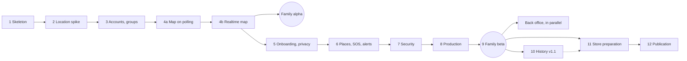

# Roadmap

> Status: draft for blueprint review · Last updated: 2026-11-17
> Related: [feature matrix](../product/feature-matrix.md) · [PRD](../product/prd.md) · [risks](risks.md) · [development workflow](../ops/development-workflow.md) · [device test matrix](../quality/device-test-matrix.md) · [NFR](../quality/nfr.md)

From an empty repository to a published app and its maintenance. There are no dates or effort estimates: the project has no deadlines, and progress is measured by stages done, not by weeks. Tasks marked 👤 need the owner (a decision, a phone in hand, an account, a payment, a review); everything else is development work inside the stage.

## 1. Overview

| # | Stage | Release | Main result | Specs |
|---|---|---|---|---|
| 1 | Walking skeleton | — | Repository, CI, Compose stack with health checks, empty app on a phone, map prototype | `001-walking-skeleton` |
| 2 | **Location spike** | — | Background sharing, push wake-up and background start paths measured on both phones against NFR targets | `002-location-spike` |
| 3 | Accounts and groups | MVP | Sign-in, groups, roles, invitations | `003-accounts`, `004-groups-invitations` |
| 4a | Live group map on polling — **first vertical slice** | MVP | Second phone visible on the map with honest freshness | `005-live-map` |
| 4b | Realtime map and fresh location | MVP | Stream updates, active view, fresh-location request; the **family alpha** starts | `006-realtime-map` |
| 5 | Onboarding, pause, privacy, deletion | MVP | Store-grade onboarding, pause, transparency, self-check, account deletion | `007-onboarding`, `008-privacy-transparency`, `009-account-deletion` |
| 6 | Places, SOS, alerts | MVP | Place alerts, SOS, low battery and "no updates" alerts | `010-places-alerts`, `011-sos`, `012-member-alerts` |
| 7 | Security hardening | MVP | Security acceptance criteria met | `013-security-hardening` |
| 8 | Production | MVP | Server in the EU, backups, monitoring; operator tasks as console commands | `014-production` |
| 9 | Family beta (+ back office in parallel) | MVP | Family uses it daily; battery and reliability measured; back office built alongside | `015-backoffice` |
| 10 | History | v1.1 | History, sharing history, retention, export | `016-history` |
| 11 | Store preparation | Play | "Only on request", store build, declarations, closed test | `017-on-request-mode`, `018-store-release` |
| 12 | Publication and maintenance | Play → v2 | App in Google Play; regular updates | per change |

### Why this order

- **The location spike comes second**, right after the skeleton: background location on real phones is the main technical risk (feature F-09, XL/H). If it does not work reliably, nothing else matters.
- **The first vertical slice (stage 4a)** ties sign-in, groups, the location engine and the map together as early as possible: register → group → invite → the second phone appears on the map with its freshness. It uses snapshot polling only. The realtime layer (`delivery` streams, tickets, active view, fresh-location requests over push) follows in stage 4b, so each stage stays one specification and the streaming risk (R-05) is isolated.
- **Family alpha from stage 4b:** the owner and one or two close people use the `internal` build against the local stack through the tunnel, without guarantees. It is not the beta (no production server, no back office), but it brings real feedback on frequency, battery and usability long before stage 9 and keeps the project moving (R-21). Alpha participants get the same operator disclosure as beta participants.
- **History moved after the beta** (from position 6 in the initial plan): history is the v1.1 release by the owner's decision; points are stored from stage 2 with retention cleanup, so v1.1 has data.
- **Places, SOS and alerts are in the MVP** (stage 6) because the family needs them daily; they reuse the server data path (places are evaluated on the server).
- **The back office is off the critical path:** until it exists, operator tasks (remote configuration, diagnostics, fresh-location request) are console commands of the core ([backend §7](../architecture/backend.md)). It is built in parallel with the family beta (stage 9) and does not delay its start.
- **Store preparation is separate (stage 11)** because Google Play policy changes the product (operator capabilities removed, "Only on request" mode) and the closed test needs 12 testers for 14 days.

Stages 10 and 11 are independent and may swap.

## 2. Stages

### Stage 1 — Walking skeleton

- **Goal:** every part of the system exists, builds, runs and is tested in CI, with nothing inside yet.
- **Stories and specs:** none directly; `001-walking-skeleton`. Map prototype answers the open point of [ADR-018](../architecture/adr/ADR-018-maps-maplibre-openfreemap.md).
- **Depends on:** blueprint approved.
- **Deliverables:** `backend/core` (Symfony on FrankenPHP, `/health`, one OpenAPI-validated endpoint `GET /v1/config`), `backend/delivery` (Go, `/health`), database image and migrations tool, `infra/docker-compose.yml` with the `test` profile, `scripts/*.ps1` (doctor, up, down, tests), `ci.yml`, Android project (`app`, `core:*` skeleton, flavors `internal`/`store`, version catalog) showing server health and a MapLibre map with the OpenFreeMap style, `install-phone.ps1`, `logcat.ps1`.
- **Definition of Done:** `scripts/doctor.ps1` passes; CI green on a pull request; the app on both phones shows "server OK" through `adb reverse` and the emulator through `10.0.2.2`; memory baseline of the stack recorded (NFR-SRV-06).
- **Demo:** 👤 run `.\scripts\up.ps1`, install the app with `.\scripts\install-phone.ps1`, see "server OK" and a map of your city on the phone.
- **Risks:** R-12 (Windows bind-mount performance), R-09 (map quality for Ukraine).
- **👤 Owner:** decide map quality is acceptable; set branch protection on GitHub.
- **What you learn:** Gradle project structure and flavors, version catalog; Docker Compose profiles and health checks; FrankenPHP; contract-first API; GitHub Actions basics; `adb`.

### Stage 2 — Location spike

- **Goal:** prove that background sharing works on the test phones and measure freshness, survival, battery, push wake-up and the ways the service can be started from the background before investing in the rest.
- **Stories and specs:** US-021 (minimal on/off), US-024, US-025 (balanced profile only), US-026; `002-location-spike`. No accounts: one shared secret per test device.
- **Depends on:** stage 1.
- **Deliverables:** `LocationService` with modes `stationary`, `moving_foot`, `moving_vehicle`, `active_view`; point filter; Room buffer; uploader; boot receiver and watchdog; engine journal screen (`internal` flavor); server ingestion with idempotent batches, server-computed time, device status and `next_report_in_s`, command in the report response; minimal FCM wake channel (high- and normal-priority test messages, delivered priority recorded in the journal); a test page or `curl` command to request a fresh location; outdoor access via Tailscale Funnel; run reports including the background start paths table (D-27).
- **Definition of Done:** spike scenarios of the [device test matrix](../quality/device-test-matrix.md) run on both phones, with default settings and after the phone-maker instructions; measured values written into [NFR](../quality/nfr.md) and engine parameters; table of background start paths filled in; go / adjust / rethink decision recorded.
- **Demo:** 👤 walk with the phone in a pocket for 30 minutes, then watch the track on the test page; leave the phone overnight and read the heartbeat and battery report; stop the service and wake it with a push from the test page.
- **Risks:** R-01 (phone-maker kills), R-02 (battery), R-03 (push wake-up), R-04 (motion detection delay), R-23 (unused-app restrictions — recorded, not measurable in a spike).
- **👤 Owner:** carry both phones through the scenarios (walks, a trip, nights, a 24-hour day); install Tailscale; create the Firebase project (moved here from stage 3); decide on optional onboarding steps (battery-optimization dialog, activity recognition).
- **What you learn:** foreground services and their types, Doze and app standby buckets, Fused Location Provider, geofences, WorkManager, idempotency, server-side time, `dumpsys batterystats`.

### Stage 3 — Accounts and groups

- **Goal:** real users and groups with roles and invitations.
- **Stories and specs:** US-001, US-002, US-003, US-004, US-007, US-010…US-017; `003-accounts`, `004-groups-invitations`.
- **Depends on:** stage 1 (stage 2 can finish in parallel).
- **Deliverables:** Google sign-in with Credential Manager; session tokens with rotation; one active device per account; groups, roles, ownership transfer, group deletion; invitations by code and app link with the web fallback page; test identity provider; authorization matrix suite started.
- **Definition of Done:** acceptance criteria covered; authorization matrix green for every new endpoint; app links verified on both phones.
- **Demo:** 👤 sign in on phone A, create a group, invite phone B by link, accept on phone B, see both members listed.
- **Risks:** R-10 (free domain and app-link verification), R-15 (Google sign-in configuration).
- **👤 Owner:** create the Google Cloud OAuth client (in the Firebase project from stage 2); register the deSEC domain.
- **What you learn:** OpenID Connect ID tokens, refresh-token rotation, Android App Links and `assetlinks.json`, DDD aggregates (Group, Membership).

### Stage 4a — Live group map on polling (first vertical slice)

- **Goal:** the second phone is visible on the map of the first with honest freshness — the product works end to end, without the realtime layer.
- **Stories and specs:** US-021, US-023, US-027, US-030…US-035 (US-030 AC2 through polling); `005-live-map`.
- **Depends on:** stages 2 and 3.
- **Deliverables:** location engine bound to the account and its groups; visibility policy with reciprocity; group snapshot endpoint; snapshot polling every 30 s while the map is on screen; map, member list and member card with freshness, accuracy, battery and status; retention cleanup of points.
- **Definition of Done:** NFR-SRV-01, NFR-SRV-02 measured; reciprocity tests green for the snapshot; NFR-DV-02 verified.
- **Demo:** 👤 phone B walks around the block; phone A watches the marker move within the polling interval, sees "Now", then puts phone B on the table and sees "At place since…, checked N min ago"; phone A pauses its own sharing and loses the view of others.
- **Risks:** R-11 (reciprocity edge cases).
- **👤 Owner:** two-phone demo.
- **What you learn:** visibility policy as a domain service, MapLibre in Compose, unidirectional data flow.

### Stage 4b — Realtime map and fresh location

- **Goal:** the map updates within seconds, and a member can ask for a fresh location; the family alpha starts.
- **Stories and specs:** US-028, US-030 AC2 (stream); `006-realtime-map`.
- **Depends on:** stage 4a.
- **Deliverables:** outbox and `LISTEN/NOTIFY`; `delivery` streams with tickets and entitlements; polling kept as the fallback; viewer presence and active-view leases (normal-priority push plus the piggyback channel); fresh-location request with high-priority push wake-up; revocation closes streams.
- **Definition of Done:** NFR-SRV-03, NFR-SRV-04, NFR-AV-05 measured; revocation tests green; D-14 and D-15 pass on both phones; alpha participants informed (operator disclosure) and installed.
- **Demo:** 👤 phone A sees phone B's marker move within seconds; tapping "Refresh" brings a fresh point and phone B shows who asked.
- **Risks:** R-03, R-05 (streams through the edge proxy), R-11.
- **👤 Owner:** two-phone demo; choose one or two alpha participants and inform them.
- **What you learn:** server-sent events, transactional outbox, `LISTEN/NOTIFY`, signed tickets, FCM priorities.

### Stage 5 — Onboarding, pause, privacy, deletion

- **Goal:** the app is honest and store-grade: disclosure before permissions, visible pause, transparency, self-check, complete deletion.
- **Stories and specs:** US-005, US-020, US-022, US-070, US-071, US-072, US-073, US-090, US-094, US-110, US-111, US-112; `007-onboarding`, `008-privacy-transparency`, `009-account-deletion`.
- **Depends on:** stage 4b.
- **Deliverables:** onboarding with prominent disclosure and two-step permissions, the unused-app restrictions step, phone-maker instructions for the test phones and the beta participants' phones; pause with timer from the app and the notification; "Who sees what about me" with the access log; reliability self-check; account deletion in the app; privacy policy and terms pages; operator disclosure screen and switches; Ukrainian and English; accessibility basics; unsupported-device check.
- **Definition of Done:** D-08, D-19, D-23, D-26, D-28 pass; D-05, D-06, D-18 re-run with the in-app instructions; deletion test finds no data in any table; screenshot tests in both languages and at large font.
- **Demo:** 👤 install fresh on phone B, go through onboarding, pause for 15 minutes and watch phone A show "Paused", open "Who sees what about me", delete a test account and confirm it disappears from the group.
- **Risks:** R-06 (store policy wording), R-01.
- **👤 Owner:** list the phones of the future beta participants (maker, model, Android version) before the stage starts, so that phone-maker instructions and D-18 cover them; approve the disclosure and privacy texts (based on [permissions rationale](../privacy/permissions-rationale.md)); approve the Ukrainian wording.
- **What you learn:** runtime permissions and background location rules, prominent disclosure, localization resources, accessibility semantics in Compose.

### Stage 6 — Places, SOS, alerts

- **Goal:** the features that make the family open the app every day.
- **Stories and specs:** US-040…US-043, US-050…US-052, US-060…US-063; `010-places-alerts`, `011-sos`, `012-member-alerts`.
- **Depends on:** stage 5 (pause and transparency rules apply to alerts).
- **Deliverables:** places with subscriptions and server-side transitions with hysteresis; SOS that overrides pause and reaches all groups; low-battery and "no updates" alerts with the heartbeat watchdog; notification preferences; push infrastructure for group events.
- **Definition of Done:** D-17, D-25 pass; D-15 re-run with revival pushes from the watchdog; no false arrival/departure alerts during D-20 and D-21; alert delivery time recorded.
- **Demo:** 👤 create "Home", subscribe on phone A, walk away and back with phone B, receive "left Home" and "arrived Home"; start SOS on phone B while paused and see it on phone A.
- **Risks:** R-07 (false alerts at night), R-03.
- **👤 Owner:** walk the place scenarios; decide alert thresholds after the first week.
- **What you learn:** PostGIS distance queries, hysteresis, Symfony Messenger and Scheduler, FCM message types and priorities.

### Stage 7 — Security hardening

- **Goal:** all [security acceptance criteria](../architecture/security.md) hold before the beta.
- **Stories and specs:** cross-cutting; `013-security-hardening`.
- **Depends on:** stages 3–6.
- **Deliverables:** complete authorization matrix; rate limits from security §6; scrubbing tests in every service and the app; store-build check; token-reuse detection; dependency audit; independent review of consent, visibility, operator and deletion code.
- **Definition of Done:** criteria 1–8, 10 and 11 of security §11 pass (criterion 9 — restore — in stage 8).
- **Demo:** 👤 read the review report and the authorization matrix output.
- **Risks:** R-11, R-14 (review by someone other than the author).
- **👤 Owner:** arrange the independent review.
- **What you learn:** STRIDE, authorization testing, rate limiting, supply-chain hygiene.

### Stage 8 — Production

- **Goal:** a server the family can rely on.
- **Stories and specs:** US-092, US-095 as console commands of the core (operator fresh-location request, publishing remote configuration); `014-production`.
- **Depends on:** stage 7.
- **Deliverables:** VM set up per [deployment](../ops/deployment.md) and sized for the free-tier idle rules; images for `arm64`; `deploy.yml`; HTTPS on the domain; backups to two locations; uptime and cron monitors; operator console commands; load test.
- **Definition of Done:** restore drill within NFR-AV-03; NFR-SRV-05 met in the load test; security criterion 9 passes; operator actions from the console appear in the subject's access log.
- **Demo:** 👤 run the operator command to request a fresh location of a test phone and see the notification on the phone; restore last night's backup locally.
- **Risks:** R-08 (free VM reclaimed or policy change), R-13 (payment card for registration).
- **👤 Owner:** register in Oracle Cloud (decide on the payment card, R-13); create object-storage accounts; keep the backup private key offline.
- **What you learn:** Linux server basics, Docker in production, TLS automation, backups and restores.

### Stage 9 — Family beta (back office in parallel)

- **Goal:** the family uses the app daily for 2–4 weeks; reliability and battery are confirmed in real life. The back office is built alongside and is not needed to start the beta.
- **Stories and specs:** all MVP stories; US-091, US-092, US-093, US-095 in the back office (`015-backoffice`); fixes go through small specs or fix branches.
- **Depends on:** stage 8.
- **Deliverables:** beta participants informed about operator capabilities before installing; builds through Firebase App Distribution; full device test matrix on both test phones and D-16 on every participant's phone; weekly review of errors and freshness statistics; beta report against [vision §9](../product/vision.md); Laravel + Filament back office with operator sign-in, overview, fresh-location request, remote configuration.
- **Definition of Done:** MVP exit criteria of the [feature matrix](../product/feature-matrix.md); no open critical issues; battery within NFR-BAT-01 or an accepted, documented deviation; back-office operator actions appear in the subject's access log.
- **Demo:** 👤 the family's own week; open the back office, see the test phones live, request a fresh location.
- **Risks:** R-01, R-02, R-07, R-16 (trust: "I did not know who could see me"), R-23 (unused-app restrictions on rarely opened phones).
- **👤 Owner:** recruit and inform participants; collect feedback; interview participants about trust; operator account for the back office.
- **What you learn:** running a real service, triage, reading crash reports, the difference between lab and real life; Laravel and Filament.

### Stage 10 — History (v1.1)

- **Goal:** "where was I / where were you" with a separate level of trust.
- **Stories and specs:** US-074, US-080…US-084; `016-history`.
- **Depends on:** stage 9.
- **Deliverables:** day view with stop detection and noise filtering; sharing history with a group or a person; retention setting and history deletion; export (JSON, GPX); per-group sharing switch; transparency screen extended. Encryption of older history reconsidered ([ADR-017](../architecture/adr/ADR-017-data-protection-without-e2e.md)).
- **Definition of Done:** retention and deletion verified by tests; export opens in a GPX viewer; authorization matrix covers history.
- **Demo:** 👤 open yesterday's history, share it with one member, revoke it.
- **Risks:** R-17 (history is the most sensitive data).
- **👤 Owner:** decide on history encryption.
- **What you learn:** track filtering and stop detection, retention of large tables (and partitioning, if measured volume asks for it — [ADR-007](../architecture/adr/ADR-007-postgresql-postgis-storage.md)), data export formats.

### Stage 11 — Store preparation

- **Goal:** a store build that passes Google Play review.
- **Stories and specs:** US-006, US-100, F-34; `017-on-request-mode`, `018-store-release`. Decision gate: the final scope of operator rights ([vision §8](../product/vision.md)) must be decided first.
- **Depends on:** stage 9 (stage 10 optional).
- **Deliverables:** "Only on request" mode; `store` flavor without operator code and `OPERATOR_MODE=off` on the server; web account deletion; store listing (icon, screenshots, descriptions in Ukrainian and English); privacy policy URL; Data safety form; background-location and foreground-service declarations with a review video; closed test with ≥ 12 testers opted in for 14 consecutive days.
- **Definition of Done:** the [store compliance checklist](../privacy/store-compliance.md) is complete; the full device test matrix passes with the `store` flavor; closed test requirement met.
- **Demo:** 👤 install the closed-test build from Google Play and go through onboarding as a new user.
- **Risks:** R-06 (review rejection), R-18 (12 testers × 14 days).
- **👤 Owner:** pay for the developer account ($25), verify identity, recruit 12 testers, record the review video, submit forms.
- **What you learn:** Play Console, app signing, store policies, review process.

### Stage 12 — Publication and maintenance

- **Goal:** the app in Google Play and kept healthy.
- **Stories and specs:** v2 features by separate specs when chosen.
- **Depends on:** stage 11.
- **Deliverables:** production access request and release; release notes; maintenance routine from [deployment §9](../ops/deployment.md); yearly `targetSdk` update; feedback channel.
- **Definition of Done:** the app is published; crash-free users ≥ NFR-APP-02; monitoring in place.
- **Demo:** 👤 install from the public Google Play listing.
- **Risks:** R-06 (policy changes), R-19 (FCM or platform changes).
- **👤 Owner:** request production access, answer reviews and feedback.
- **What you learn:** staged rollouts, maintaining a published app.

## 3. Keeping this document current

At the end of each stage: mark it done in the overview table, note what moved, add new risks to [risks.md](risks.md), and adjust the next stage if the spike or the beta changed assumptions.
