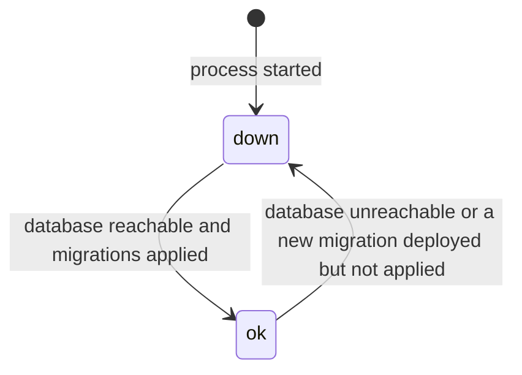

# Data model: Walking skeleton

**Feature**: [spec.md](spec.md) · **Plan**: [plan.md](plan.md) · **Research**: [research.md](research.md)

This feature stores no domain data. It defines the remote configuration document, the health status, the local configuration of the stack, the database baseline and the app's screen state.

## 1. Remote configuration (`GET /v1/config`)

Schema: `RemoteConfig` in [`api/openapi.yaml`](../../api/openapi.yaml). Built-in defaults in the core (`Platform/RemoteConfig`); no storage in this feature.

| Field | Type | Built-in default | Source / rule |
|---|---|---|---|
| `version` | integer | `1` | Increases with every published change (back office, stage 9) |
| `mapStyleUrl` | URI | `https://tiles.openfreemap.org/styles/liberty` | [ADR-018](../../docs/architecture/adr/ADR-018-maps-maplibre-openfreemap.md); exact URL confirmed in the task |
| `engine` | object (open) | see §1.1 | Keys owned by the location-engine specification (002); the app clamps values to built-in bounds |
| `limits.maxGroupMembers` | integer | `20` | BR-12 |
| `limits.maxGroupsPerUser` | integer | `10` | BR-12 |
| `limits.maxPlacesPerGroup` | integer | `20` | BR-12 |
| `limits.placeRadiusMinM` / `placeRadiusMaxM` | integer | `100` / `1000` | US-040 |
| `limits.invitationTtlH` | integer | `72` | Invitation expiry |
| `limits.sosDurationS` | integer | `900` | SOS timeout |
| `limits.sosHoldMs` | integer | `2000` | SOS hold-to-start |
| `limits.lowBatteryPct` | integer | `15` | Low-battery modifier |
| `legal.termsUrl` | URI | `${LOCATOR_PUBLIC_BASE_URL}/terms` | Pages are built in stage 5; the link exists already |
| `legal.privacyUrl` | URI | `${LOCATOR_PUBLIC_BASE_URL}/privacy` | Same |
| `legal.termsVersion` | string | `"0"` | Becomes `"1"` when the terms are published |
| `operatorMode` | boolean | `false` | `OPERATOR_MODE` environment variable (`on`/`off`, default `off`) |

### 1.1. Engine defaults

Starting values *(spike)* from [Android architecture §5.1](../../docs/architecture/android.md), `Balanced` profile. Names may be revised by spec 002; `engine` is an open object, so adding or renaming keys is not a breaking contract change.

| Key | Default |
|---|---|
| `stationaryAfterS` | `300` |
| `stationaryHeartbeatS` | `900` |
| `anchorRadiusM` | `150` |
| `footIntervalS` | `60` |
| `footMinDisplacementM` | `20` |
| `vehicleSpeedMps` | `3` |
| `vehicleIntervalS` | `30` |
| `activeViewIntervalS` | `10` |
| `activeViewLeaseS` | `120` |
| `activeViewMaxS` | `900` |
| `activeViewCooldownS` | `300` |
| `sosIntervalS` | `5` |
| `lowBatteryIntervalFactor` | `2` |

### 1.2. Validation and caching rules

- The response must validate against `RemoteConfig` (tested, FR-003).
- `ETag`: strong, quoted hash of the serialized response body; the same document always produces the same tag.
- `If-None-Match` equal to the current tag → `304 Not Modified` without a body; any other value or none → `200` with the document.
- `Cache-Control: no-cache` (clients revalidate; they refetch anyway when a report response announces a newer `configVersion`, from stage 2).
- Public: no authentication, no `401` ([contracts/openapi-changes.md](contracts/openapi-changes.md)).

## 2. Health status (`GET /health`)

Schema: `Health` in the contract: `{ "status": "ok" | "degraded" | "down" }`, no other fields.

| Service | `ok` (HTTP 200) when | `down` (HTTP 503) when |
|---|---|---|
| `core` | Database answers within ≈ 1 s **and** Doctrine Migrations reports no unexecuted migration | Otherwise |
| `delivery` | The process serves HTTP | — (no dependencies in this feature) |

`degraded` is not produced in this feature. State transitions of `core`:

## 3. Local configuration (`infra/.env`)

Every name is listed in `infra/.env.example` (committed, no secret values). `up.ps1` stops before starting services if a name is missing or empty and names it (edge case).

| Name | Example value in `.env.example` | Used by | Notes |
|---|---|---|---|
| `COMPOSE_PROJECT_NAME` | `locator` | Compose | Keeps container and volume names stable |
| `LOCATOR_HTTP_PORT` | `8080` | Compose, `install-phone.ps1`, `doctor.ps1` | Host port of `core`, bound to `127.0.0.1` |
| `LOCATOR_DB_PORT` | `15432` | Compose, `doctor.ps1` | Host port of `postgres`, bound to `127.0.0.1` |
| `LOCATOR_PUBLIC_BASE_URL` | `http://localhost:8080` | `core` | Base of legal links; a comment in `.env.example` says to change its port together with `LOCATOR_HTTP_PORT` |
| `POSTGRES_PASSWORD` | *(empty)* | `postgres` | Superuser; used only by the image's init script |
| `CORE_MIGRATOR_PASSWORD` | *(empty)* | init script, `core-migrate` | Role `core_migrator` |
| `CORE_APP_PASSWORD` | *(empty)* | init script, `core` | Role `core_app` |
| `DELIVERY_APP_PASSWORD` | *(empty)* | init script, `delivery` (from stage 4b) | Role `delivery_app`; created now so O1 holds from the start |
| `APP_SECRET` | *(empty)* | `core` | Symfony secret |
| `LOG_LEVEL` | `info` | `core`, `delivery` | `debug` only locally |
| `OPERATOR_MODE` | `off` | `core` | Reported in the remote configuration |

The `test` profile uses fixed throw-away values defined in the Compose file for `postgres-test` only — `POSTGRES_PASSWORD`, `CORE_MIGRATOR_PASSWORD`, `CORE_APP_PASSWORD`, `DELIVERY_APP_PASSWORD` (the init script needs all four) — and `core-test`/`delivery-test` use the same values; they never reach the development database.

## 4. Database baseline

| Object | Created by | Owner / rights |
|---|---|---|
| Extension `postgis` | Image init script | Superuser |
| Schema `core` | Init script | Owned by `core_migrator`; `USAGE` for `core_app` |
| Schema `delivery` | Init script | Owned by `delivery_app` |
| Default privileges in `core` | Init script, as `core_migrator` | `SELECT, INSERT, UPDATE, DELETE` on future tables and `USAGE, SELECT` on future sequences for `core_app` |
| `core.doctrine_migration_versions` | Doctrine Migrations | `core_migrator`; `SELECT` for `core_app` (health check reads it) |
| Baseline migration `Version20261123000000` (name fixed in the task) | Doctrine Migrations | Asserts the PostGIS extension exists; no tables |

Rules: the init script runs only on an empty data directory; roles, schemas and grants for later services are added by later migrations or a new init step documented in [deployment](../../docs/ops/deployment.md). No cross-schema foreign keys.

## 5. App state (`feature:map`)

| Type | Fields | Notes |
|---|---|---|
| `ServerAddress` | `baseUrl: String`, `configurable: Boolean` | From `ServerAddressProvider`; `configurable` is `false` in `store` |
| `ServerStatus` | `Reachable` · `NotReady(status)` · `Unreachable(baseUrl, reason)` | `NotReady` when `/health` answers `503`/`down` or `degraded`; `reason` is a short category (timeout, connection refused, unexpected response), never a raw exception text |
| `MapSource` | `Loading` · `Ready(styleUrl)` · `Unavailable` | `Unavailable` when the configuration cannot be read or the style fails to load |
| `MapUiState` | `address: ServerAddress`, `status: ServerStatus`, `map: MapSource`, `refreshing: Boolean` | One immutable state in a `StateFlow` |

Events: `Refresh` (re-reads health and configuration). Timeouts: connect 3 s, request 5 s (SC-003: status within 5 s of opening).

Default camera: latitude 50.4501, longitude 30.5234, zoom 11 (constant `DefaultCamera` in `feature:map`).
